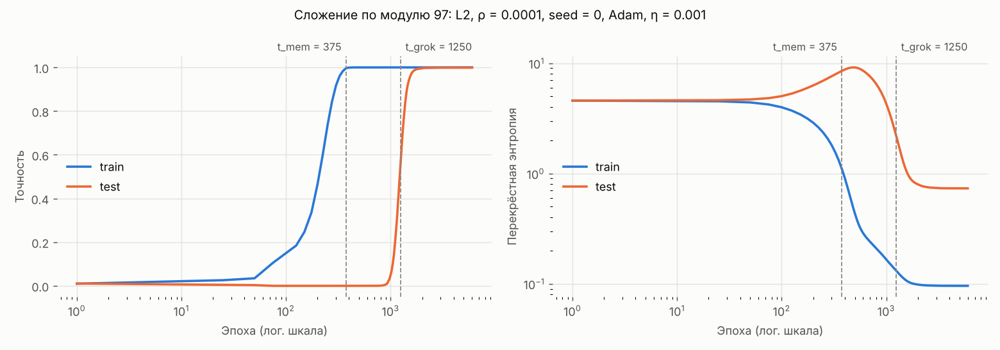

# Эффект отложенного обобщения (grokking) при обучении нейронных сетей

Курсовая работа по дисциплине «Нейронные сети», ВИШ РУТ (МИИТ), осенний семестр 2026.
Команда из трёх человек.

**Grokking** — эффект, при котором сеть сначала запоминает обучающую выборку (точность на
train → 100%, на test — около случайной), а затем, спустя во много раз больше эпох,
внезапно находит обобщающее правило, и точность на test тоже растёт до ~100%.



*Пилот: q = 97, доля train 0.4, сеть 194 → 256 → 97, Adam, η = 1e-3, L2-штраф ρ = 1e-4.
Train запомнен к 375-й эпохе (t_mem), test в это время ≈ 0, а test-лосс растёт. Переход
к обобщению по нашему критерию — на 1250-й эпохе (t_grok), в 3.3 раза позже запоминания.*

---

## Задание

1. Построить датасет всех пар (x1, x2) для y = (x1 + x2) mod q (q простое, q ~ 100),
   one-hot представление x1, x2, y. Случайно выделить фиксированную долю пар для обучения.
2. Обучить небольшую полносвязную сеть, сохраняя точность на train и test по ходу обучения.
   Подбором η добиться grokking. Описать, как эффект проявляется на графиках.
3. Построить кривые лосса и точности, выделить эпоху перехода от запоминания к обобщению.
   Предложить **числовой критерий (задачу оптимизации)** для её автоматического и
   однозначного поиска, проверить его.
4. Повторить для нескольких η и коэффициентов регуляризации ρ, отдельно для L1 и L2,
   остальное зафиксировать. Каждую пару (η, ρ) — многократно с разными seed. Исследовать
   зависимость момента перехода от типа регуляризации, η и ρ.

Опорная статья: *Grokking Beyond the Euclidean Norm of Model Parameters*, PMLR 267:28552–28618, 2025.

---

## Документация

| Документ | Содержание |
|---|---|
| [docs/ARCHITECTURE.md](docs/ARCHITECTURE.md) | Модули, их интерфейсы, поток данных, форматы файлов, принятые решения, тесты, риски |
| [docs/EXPERIMENTS.md](docs/EXPERIMENTS.md) | Методология по пунктам 1–4: критерий перехода, сетка, цензурирование, гипотезы и тесты |
| [docs/PLAN.md](docs/PLAN.md) | Роли участников, календарный план до 10.12.2026, контракты, соответствие критериям оценки |
| [docs/PILOT_RESULTS.md](docs/PILOT_RESULTS.md) | Результаты пилота: что уже проверено и какие стартовые значения выбраны |

---

## Статус

| Этап | Состояние |
|---|---|
| Архитектура и план | ✅ готово |
| Пилот (однофайловый прототип) | ✅ grokking воспроизводится, стартовые η и ρ выбраны |
| Пакет `src/grokking` | ⏳ неделя 1 (R1) |
| Критерий момента перехода | ⏳ недели 1–3 (R2) |
| Сетка экспериментов и статистика | ⏳ недели 2–6 (R3) |
| Отчёт | ⏳ недели 6–7 |

---

## Быстрый старт

Нужен Python ≥ 3.12.

```bash
git clone https://github.com/Alectobe/grokking-modular-addition.git
cd grokking-modular-addition
python -m venv .venv
source .venv/bin/activate          # Windows: .venv\Scripts\activate
pip install -r requirements.txt
```

Пилотный прогон — та же постановка, что на картинке выше (~3 минуты на 4-ядерном CPU):

```bash
python pilot/pilot_grokking.py --reg l2 --lr 1e-3 --rhos 1e-4 --seeds 0 1 \
    --steps 3000 --eval-every 25 --out pilot_runs/demo
```

Результат: `pilot_runs/demo/curves.png` (кривые), `summary.json` (моменты запоминания и
обобщения по репликам), `metrics.npz` (все кривые в формате из ARCHITECTURE.md §5).

---

## Структура (целевая)

```text
configs/      YAML-конфиги: базовый, подбор η, сетки для L1 и L2
src/grokking/ пакет: данные, модель, обучение, хранение, детекция, статистика, графики
scripts/      точки входа: train, run_grid, detect, analyze
notebooks/    только чтение результатов и графики, по пунктам задания
tests/        pytest
pilot/        однофайловый прототип, проверенный пилотом
docs/         архитектура, методология, план
report/       отчёт и графики для него
```

Подробно — в [docs/ARCHITECTURE.md §3](docs/ARCHITECTURE.md#3-структура-репозитория).

---

## Сроки

- Код и отчёт — до **10.12.2026, 23:59 МСК**, только через Google-форму курса. Внутренний срок — 08.12.
- Устная защита — не раньше 14.12.2026.
