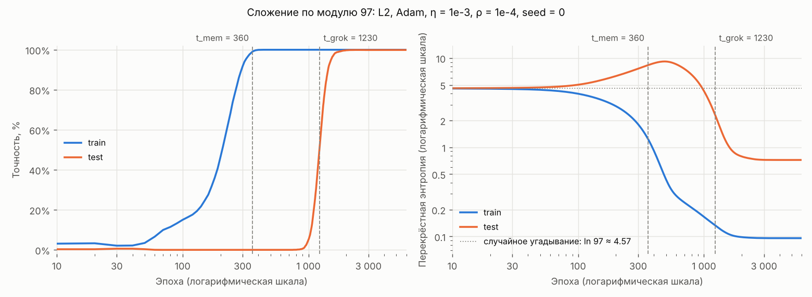

# Эффект отложенного обобщения (grokking) при обучении нейронных сетей

Курсовая работа по дисциплине «Нейронные сети», ВИШ РУТ (МИИТ), осенний семестр 2026.
Команда из трёх человек.

**Grokking** — эффект, при котором сеть сначала запоминает обучающую выборку (точность на
train → 100%, на test — около нуля), а затем, спустя в разы больше эпох, внезапно находит
обобщающее правило, и точность на test тоже поднимается почти до 100%.



*q = 97, доля train 0.4, сеть 194 → 256 → 97, Adam, η = 1e-3, L2-штраф ρ = 1e-4. Train запомнен
к 360-й эпохе (t_mem), test в это время на нуле, а тестовый лосс растёт. Переход к обобщению по
нашему критерию — около 1230-й эпохи (t_grok).*

---

## Главные результаты

| Вопрос | Ответ |
|---|---|
| Есть ли grokking (п. 2)? | Да. При η = 1e-3 и L2-штрафе ρ = 1e-4 сеть запоминает train к 360-й эпохе, а обобщает к ~1230-й. Эффект есть при η от 3e-4 до 3e-2 |
| Как найти момент перехода (п. 3)? | Подогнать к кривой test_acc ступеньку методом наименьших квадратов на логарифмической шкале эпох. Решение точное и единственное; на синтетике медианная ошибка 2.6%, ложных срабатываний 0 из 300 |
| Нужна ли регуляризация? | Да: без неё ни одна из 18 сетей не обобщила за 6000 эпох, с L2 обобщили все 90 |
| Что сильнее влияет — η или ρ (п. 4)? | η: t_grok ∝ η^(−0.73)·ρ^(−0.15) для L2. При Adam время до перехода задаёт в основном скорость обучения; гипотеза «важно только η·ρ» отвергнута |
| L1 или L2 (п. 4)? | L2 даёт полное обобщение во всех запусках. L1 — отложенный скачок, но обобщение только частичное (25–72%) и в 1.9–2.2 раза позже |
| Что выучивает сеть? | В момент перехода нейроны первого слоя становятся синусоидами по входу (Фурье-механизм модульного сложения). L1 выключает около двух третей нейронов |

Подробно — в [report/REPORT.md](report/REPORT.md).

---

## Задание

1. Построить датасет всех пар (x1, x2) для y = (x1 + x2) mod q (q простое, q ~ 100), one-hot
   представление x1, x2, y. Случайно выделить фиксированную долю пар для обучения.
2. Обучить небольшую полносвязную сеть, сохраняя точность на train и test по ходу обучения.
   Подбором η добиться grokking. Описать, как эффект проявляется на графиках.
3. Выделить эпоху перехода от запоминания к обобщению. Предложить **числовой критерий (задачу
   оптимизации)** для её автоматического и однозначного поиска, проверить его.
4. Повторить для нескольких η и ρ отдельно для L1 и L2, каждую пару — с разными seed.
   Исследовать зависимость момента перехода от типа регуляризации, η и ρ.

Опорная статья: *Grokking Beyond the Euclidean Norm of Model Parameters*, PMLR 267:28552–28618, 2025.

---

## Документы

| Документ | Содержание |
|---|---|
| [report/REPORT.md](report/REPORT.md) | **Текстовый отчёт**: постановка, метод, результаты по всем пунктам, выводы |
| [docs/TALK.md](docs/TALK.md) | **Сценарий выступления** на троих по ролям и шпаргалка ответов на вопросы |
| [docs/ARCHITECTURE.md](docs/ARCHITECTURE.md) | Модули и их интерфейсы, поток данных, форматы файлов, принятые решения |
| [docs/EXPERIMENTS.md](docs/EXPERIMENTS.md) | Методология: критерий перехода, сетка, цензурирование, гипотезы и тесты |
| [docs/PILOT_RESULTS.md](docs/PILOT_RESULTS.md) | Пилот и калибровка: что проверили до запуска сетки |
| [docs/PLAN.md](docs/PLAN.md) | Роли, план работ, соответствие критериям оценки |

---

## Установка

Нужен Python ≥ 3.12.

```bash
git clone https://github.com/Alectobe/grokking-modular-addition.git
cd grokking-modular-addition
python -m venv .venv
source .venv/bin/activate          # Windows: .venv\Scripts\activate
pip install -r requirements.txt
python -m pytest -q                # 35 тестов, ~10 секунд
```

## Воспроизведение

Метрики всех запусков уже лежат в `results/`, поэтому таблицы и графики отчёта можно
перестроить за секунды, без переобучения:

```bash
python scripts/detect.py --results results/lr_sweep results/grid_l2 results/grid_l1 \
    --out results/detections.csv
python scripts/validate_criterion.py --detections results/detections.csv \
    --results results/grid_l2 results/grid_l1 --figures report/figures --tables report/tables
python scripts/analyze.py --detections results/detections.csv --results results \
    --figures report/figures --tables report/tables
```

Обучение с нуля (210 сетей; ~3 часа на 4-ядерном CPU). На той же машине и с тем же числом
потоков результаты совпадают бит в бит; на другом процессоре могут отличаться последние знаки,
а t_mem и t_grok — сдвинуться на шаг записи (10 эпох):

```bash
rm -rf results/lr_sweep results/grid_l2 results/grid_l1
python scripts/run_grid.py --grid configs/lr_sweep.yaml configs/grid_l2.yaml configs/grid_l1.yaml --order lr
```

Чтобы поделить обучение между тремя машинами, каждый запускает свою часть (`--shard 1/3`,
`--shard 2/3`, `--shard 3/3`), а потом каталоги `results/` объединяются. Готовые задания
пропускаются, поэтому после падения достаточно повторить ту же команду.

| Результат | Откуда |
|---|---|
| `report/figures/grokking_demo.png`, `lr_sweep.png`, таблица `lr_sweep` | `analyze.py` по `results/lr_sweep` (п. 2) |
| `criterion_*.png`, таблицы `criterion_*` | `validate_criterion.py` (п. 3) |
| `tgrok_vs_*.png`, `end_accuracy.png`, `rho_sweep_*.png`, `norm_dynamics.png`, таблицы `grid_summary`, `h1`–`h5`, `robustness_criteria` | `analyze.py` по `results/grid_*` (п. 4) |
| `fourier.png`, таблица `fourier` | `fourier.py` по `results/fourier` (нужны чекпоинты весов, см. ниже) |
| Таблицы внутри `report/REPORT.md` | `python scripts/fill_report.py --report report/REPORT.md --tables report/tables` |

Фурье-анализу нужны сохранённые веса (~30 МБ, в git не входят). Их пересчёт занимает ~15 минут
(в конфиге один поток, чтобы не мешать параллельным вычислениям):
`python scripts/run_grid.py --grid configs/fourier.yaml`, затем
`python scripts/fourier.py --results results/fourier --figures report/figures --tables report/tables`.

---

## Структура

```text
configs/      YAML-конфиги: базовый, подбор η, сетки для L1 и L2
src/grokking/ пакет: данные, модель, обучение, хранение, детекция, статистика, графики
scripts/      точки входа: run_grid, train, detect, validate_criterion, analyze
tests/        pytest
results/      метрики всех запусков (metrics.npz, config.yaml, meta.json)
report/       отчёт, графики и таблицы
pilot/        однофайловый прототип, с которого начинался проект
docs/         архитектура, методология, план, сценарий выступления
```

## Роли

| Роль | Зона ответственности | Модули |
|---|---|---|
| R1 — ядро обучения | Данные, модель, обучение, хранение, воспроизводимость | `config`, `data`, `model`, `regularization`, `train`, `storage`, `grid`, `utils`, `run_grid.py`, `train.py` |
| R2 — критерий перехода | Критерий момента перехода, его проверка, п. 2–3 | `detection`, `detect.py`, `validate_criterion.py` |
| R3 — эксперименты и статистика | Сетка, анализ, гипотезы, графики, п. 4 | `stats`, `plotting`, `report`, `analyze.py` |

## Сроки

Код и отчёт — до **10.12.2026, 23:59 МСК**, только через Google-форму курса. Устная защита —
не раньше 14.12.2026.
