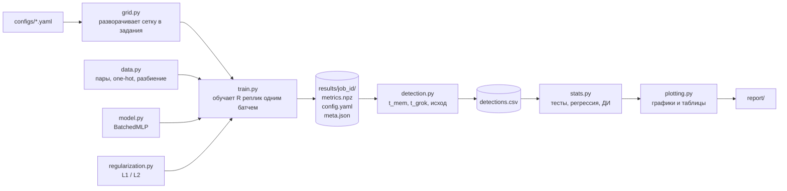

# Архитектура решения

Документ описывает, **из каких частей состоит код, как они связаны и почему устроены именно так**.
Методология экспериментов (критерий, сетка, статистика) вынесена в [EXPERIMENTS.md](EXPERIMENTS.md).
Распределение работ — в [PLAN.md](PLAN.md).

---

## 1. Постановка в терминах эксперимента

| Что | Решение |
|---|---|
| Объект анализа | Одна **реплика** — сеть, обученная с конкретными (тип регуляризации, η, ρ, seed) |
| Задача | Классификация: (x1, x2) → y = (x1 + x2) mod q, q — простое, q = 97 |
| Данные | Все q² = 9409 пар; фиксированная доля в train (по умолчанию 0.4), остальное в test |
| Представление | Вход — конкатенация one-hot(x1) и one-hot(x2), длина 2q = 194; цель — one-hot(y), длина q |
| Модель | Полносвязная сеть 194 → H → 97, ReLU, H = 256 (уточняется в п. 2 задания) |
| Функция потерь | Перекрёстная энтропия с one-hot целью + штраф ρ·R(θ), R ∈ {L1, L2} |
| Метрики | Точность (accuracy) и CE на train и test; L1- и L2-нормы весов; доля почти нулевых весов |
| Гранулярность времени | **Эпоха = один шаг оптимизатора** (обучение полнобатчевое) |
| Отклики для п. 4 | Эпоха перехода t_grok (критерий из EXPERIMENTS.md §3) и эпоха полного обобщения t_gen95 (EXPERIMENTS.md §5) |

---

## 2. Поток данных



`data.py`, `model.py` и `regularization.py` подключаются к обучению внутри одного процесса.
А **этапы** — обучение → детекция → статистика → графики — связаны только файлами
(`metrics.npz` → `detections.csv` → таблицы). Поэтому любой этап можно перезапустить отдельно:
пересчитать детекцию без переобучения, статистику — без повторной детекции.

---

## 3. Структура репозитория

```text
grokking-modular-addition/
├── README.md                    # как установить и воспроизвести каждый результат
├── requirements.txt             # закреплённые версии зависимостей
├── pyproject.toml               # пакет grokking + настройки ruff и pytest
├── configs/
│   ├── base.yaml                # базовый конфиг: все фиксированные параметры
│   ├── lr_sweep.yaml            # п. 2: подбор η для демонстрации эффекта
│   ├── grid_l1.yaml             # п. 4: сетка (η, ρ) для L1
│   ├── grid_l2.yaml             # п. 4: сетка (η, ρ) для L2
│   └── fourier.yaml             # доп.: реплики с сохранением весов для Фурье-анализа
├── src/grokking/
│   ├── __init__.py
│   ├── config.py                # dataclass-схема конфига, загрузка и проверка YAML
│   ├── data.py                  # датасет модульного сложения
│   ├── model.py                 # BatchedMLP: R независимых сетей в одном тензоре
│   ├── regularization.py        # штрафы L1 / L2 по репликам
│   ├── train.py                 # цикл обучения и вычисление метрик
│   ├── storage.py               # запись и чтение результатов одного задания
│   ├── detection.py             # критерий момента перехода и классификация исходов
│   ├── grid.py                  # разворачивание сетки в задания, возобновление
│   ├── stats.py                 # статистический анализ
│   ├── plotting.py              # единый стиль графиков
│   ├── report.py                # таблицы для отчёта: CSV и Markdown
│   └── utils.py                 # фиксация seed, детерминизм, выбор устройства
├── scripts/
│   ├── train.py                 # обучить по одному конфигу
│   ├── run_grid.py              # обучить всю сетку (с возобновлением и --shard)
│   ├── detect.py                # results/ -> detections.csv
│   ├── validate_criterion.py    # п. 3: проверка критерия на синтетике и реальных запусках
│   ├── analyze.py               # п. 2 и п. 4: таблицы, графики, гипотезы H1–H5
│   ├── fourier.py               # доп.: Фурье-структура весов первого слоя
│   └── fill_report.py           # вставка таблиц анализа в report/REPORT.md
├── tests/
│   ├── test_config.py
│   ├── test_data.py
│   ├── test_model.py            # в том числе совпадение с пилотом бит в бит
│   ├── test_regularization.py
│   ├── test_detection.py
│   ├── test_stats.py
│   └── test_report.py
├── pilot/
│   ├── pilot_grokking.py        # однофайловый прототип обучения; источник логики для src/
│   ├── pilot_changepoint.py     # прототип критерия перехода
│   └── pilot_plotting.py        # графики пилота: единый стиль, читаемые оси
├── docs/                        # архитектура, методология, план, результаты пилота
├── results/                     # в .gitignore, кроме detections.csv
└── report/
    ├── REPORT.md                # текстовый отчёт
    ├── figures/                 # графики отчёта (строятся скриптами)
    └── tables/                  # таблицы отчёта (CSV + Markdown) и results.json
```

Обучение и детекция живут в `src/` и вызываются из `scripts/`. Вместо запланированных
ноутбуков все таблицы и графики строят `scripts/validate_criterion.py`, `scripts/analyze.py`
и `scripts/fourier.py`:
из-за сжатых сроков так быстрее, а каждый результат воспроизводится одной командой из README.

---

## 4. Конфигурация

Все параметры, влияющие на результат, задаются в YAML и загружаются в замороженный
`dataclass` (`config.py`). Загрузчик проверяет типы и диапазоны: q — простое,
0 < train_frac < 1, lr > 0, rho ≥ 0, kind ∈ {none, l1, l2}. Неизвестные ключи вызывают ошибку,
поэтому опечатка в конфиге не превращается молча в значение по умолчанию.

Полный базовый конфиг: [`configs/base.yaml`](../configs/base.yaml). Конфиг эксперимента
ссылается на базовый (`base:`) и содержит три секции:

| Секция | Смысл |
|---|---|
| `overrides` | Поля, которые в этом эксперименте фиксированы, но отличаются от `base.yaml` (например, `regularization.kind`) |
| `grid.jobs_over` | Декартово произведение значений → отдельные **задания** (процессы). Сюда идут поля, общие для всех реплик задания: `optimizer.lr`, `regularization.kind` |
| `grid.replicas_over` | Декартово произведение значений × `replicas.seeds` → **реплики** внутри задания. Допустимо только для полей, которые могут различаться у реплик одного батча: сейчас это `regularization.rho` |

Загрузчик отклоняет поле в `replicas_over`, которое не может отличаться между репликами
(например, `optimizer.lr`: у Adam одна скорость обучения на тензор параметров).

Примеры: [`configs/lr_sweep.yaml`](../configs/lr_sweep.yaml), [`configs/grid_l2.yaml`](../configs/grid_l2.yaml),
[`configs/grid_l1.yaml`](../configs/grid_l1.yaml).

---

## 5. Формат хранения результатов

Одно **задание** (job) = один процесс обучения = фиксированные (тип, η) и R реплик,
различающихся парой (ρ, seed).

```text
results/<experiment>/<job_id>/
├── config.yaml      # полный развёрнутый конфиг задания (после подстановки сетки)
├── meta.json        # версии библиотек, git commit, устройство, время, статус
├── metrics.npz      # кривые обучения
└── checkpoints/     # опционально: веса на выбранных эпохах (для 04_mechanism)
    └── step_<t>.pt
```

`job_id` — `<тип>-lr<η>-<хеш>`, где хеш — первые 10 символов sha1 развёрнутого конфига
(например, `l2-lr0.001-cbefd5534c`). Повторный запуск сетки пропускает задания,
у которых уже есть `meta.json` со статусом `done`.

### `metrics.npz`

| Ключ | Форма | Тип | Смысл |
|---|---|---|---|
| `step` | (T,) | int64 | Эпохи, на которых считались метрики (0, k, 2k, …) |
| `rho` | (R,) | float64 | ρ реплики |
| `seed` | (R,) | int64 | seed инициализации реплики |
| `train_loss`, `test_loss` | (T, R) | float32 | CE без штрафа |
| `train_acc`, `test_acc` | (T, R) | float32 | Точность |
| `penalty` | (T, R) | float32 | Значение R(θ) (без множителя ρ) |
| `l1_norm`, `l2_norm` | (T, R) | float32 | Σ\|w\| и √(Σw²) по матрицам весов |
| `frac_small` | (T, R) | float32 | Доля весов с \|w\| < 1e-3 (разреженность, важна для L1) |

### `detections.csv` (выход `scripts/detect.py`)

Одна строка на реплику:

```text
experiment, job_id, reg_kind, lr, rho, seed,
outcome,            # grokking | partial | simultaneous | no_generalization | no_memorization
t_mem,              # первая эпоха с train_acc ≥ 0.99
t_grok,             # эпоха перехода (основной критерий), пусто если не найдена
censored,           # True, если скачка не было до конца обучения (t_grok > T)
t_grok_thr50,       # альтернативный критерий: пересечение середины
t_grok_logderiv,    # альтернативный критерий: максимум производной по log t
t_gen95,            # первая эпоха, начиная с которой test_acc ≥ 0.95 (пусто, если не достигнута)
censored_gen95,     # True, если test_acc ≥ 0.95 не достигнута до конца обучения
end_test_acc,       # среднее test_acc на последних 5% эпох
jump,               # величина скачка test_acc в точке перехода
final_train_acc, final_test_acc
```

---

## 6. Модули: ответственность и публичный интерфейс

Ниже — **контракт** модулей: сигнатуры, которые участники реализуют и на которые опираются
другие модули. Реализация ориентируется на `pilot/pilot_grokking.py`.

### `config.py`

```python
@dataclass(frozen=True)
class DataConfig:
    q: int
    train_frac: float
    split_seed: int

@dataclass(frozen=True)
class ModelConfig:
    d_hidden: int
    n_hidden_layers: int
    activation: Literal["relu"]

@dataclass(frozen=True)
class OptimizerConfig:
    name: Literal["adam", "sgd"]
    lr: float
    betas: tuple[float, float]
    eps: float

@dataclass(frozen=True)
class RegularizationConfig:
    kind: Literal["none", "l1", "l2"]
    rho: tuple[float, ...]          # после развёртывания сетки — по одному значению на реплику
    apply_to: Literal["weights"]

@dataclass(frozen=True)
class Config:
    experiment_name: str
    output_root: Path
    data: DataConfig
    model: ModelConfig
    optimizer: OptimizerConfig
    regularization: RegularizationConfig
    epochs: int
    dtype: Literal["float32", "float64"]
    eval_every: int
    checkpoint_steps: tuple[int, ...]
    seeds: tuple[int, ...]          # после развёртывания сетки — по одному значению на реплику
    device: Literal["auto", "cpu", "cuda"]
    deterministic: bool
    threads: int

def load_config(path: Path) -> Config     # base.yaml + overrides, с проверками
def config_hash(cfg: Config) -> str       # job_id: первые 10 символов sha1 канонического YAML
```

### `data.py`

```python
@dataclass(frozen=True)
class ModularAdditionData:
    q: int
    X_train: torch.Tensor      # (N_train, 2q), float32, one-hot(x1) ⊕ one-hot(x2)
    Y_train: torch.Tensor      # (N_train, q),  float32, one-hot(y)
    X_test: torch.Tensor
    Y_test: torch.Tensor
    pairs_train: torch.Tensor  # (N_train, 2), int64 — исходные (x1, x2) для анализа
    pairs_test: torch.Tensor

def make_modular_addition(q: int, train_frac: float, split_seed: int) -> ModularAdditionData
```

- Разбиение зависит **только** от `split_seed` и одинаково для всех экспериментов.
  Тогда разброс между seed отражает случайность инициализации, а не выборки.
- Проверки: q простое, train и test не пересекаются, вместе дают все q² пар.

### `model.py`

```python
class BatchedMLP(nn.Module):
    def __init__(self, seeds: Sequence[int], d_in: int, d_hidden: int, d_out: int,
                 n_hidden_layers: int = 1): ...
    def forward(self, X: torch.Tensor) -> torch.Tensor:      # (N, d_in) -> (R, N, d_out)
    def weight_matrices(self) -> list[torch.Tensor]:          # [(R, d_in_l, d_out_l), ...]
```

**Ключевое решение — векторизация по репликам.** Веса R сетей хранятся в тензорах с
ведущей осью R, прямой проход — через `torch.baddbmm`. Реплики остаются независимыми,
потому что:

1. общий лосс равен сумме лоссов реплик, поэтому градиент по весам реплики r зависит только
   от её собственного лосса;
2. Adam обновляет каждый элемент тензора независимо;
3. глобальный клиппинг градиента запрещён: он связал бы реплики.

Каждая реплика инициализируется своим `torch.Generator(seed)` по схеме `nn.Linear`
(равномерно в ±1/√fan_in). Её веса не зависят от того, с какими репликами она обучается
в одном батче. Это проверяется тестом: R = 3 в одном батче против трёх запусков с R = 1,
совпадение до 1e-5.

Зачем это нужно: сеть маленькая (~75 тыс. параметров), и на GPU одна реплика не загружает
устройство. Батч из десятков реплик там проходит за время, сопоставимое с одной репликой.
**На CPU выигрыша нет** — это замерено в пилоте (4 потока, q = 97, H = 256, доля train 0.4):

| R (реплик в батче) | 1 | 6 | 30 |
|---|---|---|---|
| Время шага, мс | 12 | 89 | 449 |
| На одну реплику, мс | 12 | 15 | 15 |

Процессор загружен уже одной репликой, поэтому на CPU сетку ускоряет только распределение
заданий между машинами участников. Векторизацию всё равно оставляем: на CPU она ничего
не стоит, а на GPU (Colab / Kaggle) окупается. Ускорение на GPU пока **не замерялось**:
это задача R1 до вехи M3 (25.11), если у команды есть GPU.

Первый слой можно было бы считать выборкой строк W₁ по индексам x1 и q + x2 вместо умножения
на one-hot (математически это одно и то же). На CPU замер выигрыша не показал (при R = 30
прямой проход через выборку в 2.6 раза медленнее умножения), поэтому оставляем честное
умножение на one-hot — так буквально выполняется требование задания.

### `regularization.py`

```python
def penalty(model: BatchedMLP, kind: Literal["none", "l1", "l2"]) -> torch.Tensor  # (R,)
```

- L1: R(θ) = Σ\|w\|, L2: R(θ) = Σw². Суммирование идёт по всем матрицам весов,
  **смещения не штрафуются**.
- В лосс штраф входит как `ce + rho * penalty`, где `rho` — вектор (R,). Поэтому реплики
  с разными ρ обучаются в одном батче.

### `train.py`

```python
def train_job(cfg: Config, out_dir: Path) -> None
```

- Полнобатчевое обучение фиксированное число эпох `training.epochs` без ранней остановки.
  Так у всех реплик одинаковый горизонт наблюдения, и цензурирование
  (EXPERIMENTS.md §5) определено одинаково.
- Метрики считаются каждые `eval.every` эпох в `torch.no_grad()` по всему train и test.
- Оптимизатор — Adam (β = (0.9, 0.98)) **без встроенного weight decay**. Регуляризация
  входит только явным штрафом в лосс. Почему не AdamW — см. §7.

### `storage.py`

```python
def save_job(out_dir: Path, cfg: Config, metrics: dict[str, np.ndarray], meta: dict) -> None
def load_job(job_dir: Path) -> JobRecord      # config + metrics + meta
def iter_jobs(root: Path) -> Iterator[JobRecord]
```

Запись атомарная: сначала во временный файл, затем переименование. `meta.json` пишется
последним, поэтому задание без `meta.json` считается незавершённым и пересчитывается.

### `detection.py`

```python
@dataclass(frozen=True)
class DetectionParams:
    mem_threshold: float = 0.99
    gen_threshold: float = 0.95
    min_jump: float = 0.3
    simultaneous_threshold: float = 0.5
    tail_fraction: float = 0.05
    log_grid_points: int = 400   # ступенька ищется на равномерной сетке по log t
    smooth_window: int = 9

@dataclass(frozen=True)
class Detection:
    outcome: str        # grokking | partial | simultaneous | no_generalization | no_memorization
    t_mem: int | None
    t_grok: int | None
    censored: bool
    jump: float | None
    t_grok_thr50: int | None
    t_grok_logderiv: int | None
    t_gen95: int | None
    censored_gen95: bool
    end_test_acc: float
    final_train_acc: float
    final_test_acc: float

def changepoint_l2(values) -> tuple[int, float]                  # индекс разрыва, SSE; O(n)
def log_resample(steps, values, start_idx, n_points) -> (t_grid, values_grid)
def detect(steps, train_acc, test_acc, params=None) -> Detection
def threshold_crossing(steps, test_acc, start_idx, level) -> int | None
def max_log_derivative(steps, test_acc, start_idx, window) -> int | None
def sigmoid_midpoint(steps, test_acc, start_idx, t_init) -> int | None
def stable_crossing(steps, values, level) -> int | None          # t_gen95: с этой эпохи и до конца >= level
def synthetic_curves(steps, t_mem, t_star, width, low, high, noise, rng, dip=None) -> (train, test)
```

Определение критерия и его проверка — в [EXPERIMENTS.md §3](EXPERIMENTS.md#3-критерий-момента-перехода-п-3).

### `grid.py`

```python
def expand_grid(grid_cfg_path: Path) -> list[Config]        # одно задание = (тип, η)
def job_dir(cfg: Config) -> Path                            # <output_root>/<experiment>/<job_id>
def pending_jobs(jobs: list[Config]) -> list[Config]
def shard(jobs: list[Config], index: int, count: int) -> list[Config]  # детерминированно по job_id
```

`scripts/run_grid.py --grid configs/grid_l2.yaml --shard 1/3` запускает треть заданий.
Каждый участник считает свою треть на своей машине, а папки `results/` потом
объединяются: задания не пересекаются, потому что `job_id` — хеш конфига.

### `stats.py`

```python
def summarize(det) -> pd.DataFrame                  # по ячейкам: исходы, медиана и квартили t_grok (Каплан–Мейер)
def km_quantile(times, observed, q) -> float        # квантиль времени до события с учётом цензуры
def spearman_trend(det, x, within) -> pd.DataFrame  # H1/H2: Спирмен log x ↔ t_grok, поправка Холма
def scaling_fit(det, kind) -> dict                  # H3: log t_grok = c − α·log η − β·log ρ, проверка α = β
def compare_kinds_best(det) -> pd.DataFrame         # H4: лучшее t_grok при каждом η, L2 против L1
def compare_kinds_completeness(det) -> dict         # H4: доля полного обобщения, тест Фишера
def compare_slopes(fit_a, fit_b) -> dict            # H4: разность наклонов β
def norm_tests(det) -> pd.DataFrame                 # H5: нормы и разреженность весов
def holm(p), cliffs_delta(a, b), bootstrap_median_ratio(a, b)
```

### `plotting.py`

Один модуль задаёт общий стиль: палитру, лог-шкалу по эпохам с подписями обычными
числами, точность в процентах, уровень случайного угадывания на графике кросс-энтропии.
Все графики отчёта строятся функциями отсюда.

### `utils.py`

```python
def set_global_seed(seed: int) -> None            # random, numpy, torch
def enable_determinism() -> None                  # torch.use_deterministic_algorithms(True), CUBLAS_WORKSPACE_CONFIG
def resolve_device(name: str) -> torch.device
def environment_info(device) -> dict              # версии, git commit, устройство -> meta.json
```

---

## 7. Принятые решения и их обоснование

| Решение | Альтернатива | Почему выбрали так |
|---|---|---|
| Полнобатчевое обучение, эпоха = шаг | Мини-батчи | Датасет маленький (~3.8 тыс. объектов в train). Кривые без шума сэмплирования, «номер эпохи» однозначен, разброс между seed — только от инициализации |
| Явный штраф в лоссе + Adam | AdamW (развязанный weight decay) | Задание требует сравнить L1 и L2 с коэффициентом ρ. Явный штраф задаёт оба типа одинаково. У AdamW нет L1-аналога, и сравнение L1-штрафа с L2-decay было бы сравнением разных механизмов. Риск: Adam + L2 в лоссе регуляризует слабее, чем AdamW (Loshchilov & Hutter, 2019). Пилот проверяет, что grokking при этом есть |
| CE с one-hot целью | MSE на one-hot | Стандарт для классификации, вероятностная интерпретация. One-hot цель выполняет требование задания буквально, а математически совпадает с CE по индексу класса |
| Смещения без штрафа | Штраф на все параметры | Стандартная практика: смещения не отвечают за сложность решения |
| Фиксированное разбиение train/test | Своё разбиение на каждый seed | Изолирует один источник случайности — инициализацию. Устойчивость к разбиению можно проверить отдельным экспериментом на 2–3 разбиениях |
| Фиксированное число эпох, без ранней остановки | Остановка после обобщения | Одинаковый горизонт → корректный учёт цензурирования |
| float32 | float64 | Быстрее. Риск: после запоминания логиты растут, и в float32 softmax может «насыщаться», останавливая обучение (Prieto et al., 2025, «Grokking at the Edge of Numerical Stability»). С регуляризацией нормы весов ограничены, поэтому риск мал. Контроль — повторить 2–3 конфигурации в float64 |
| R реплик в одном тензоре | Отдельный процесс на реплику | Ускорение на GPU; на CPU нейтрально (замерено). Независимость реплик доказывается тестом |

---

## 8. Воспроизводимость

1. Все seed (`split_seed`, seed каждой реплики) — в конфиге и в `metrics.npz`.
2. `enable_determinism()` в начале каждого запуска. На CPU результаты совпадают бит в бит,
   на GPU — с точностью до детерминированных ядер cuBLAS.
3. `meta.json` хранит версии Python, PyTorch и NumPy, git commit и устройство.
4. `requirements.txt` с закреплёнными версиями.
5. В README у каждого графика из отчёта есть команда, которая его воспроизводит.
6. Перед сдачей (веха M6) один участник клонирует репозиторий в чистое окружение и
   воспроизводит результаты строго по README.

---

## 9. Тестирование

| Тест | Что проверяет |
|---|---|
| `test_data.py` | q² пар; train ∩ test = ∅; train ∪ test = все пары; y = (x1 + x2) mod q; one-hot корректен; одинаковый `split_seed` → одинаковое разбиение |
| `test_model.py` | Формы выходов; одинаковый seed → одинаковые веса; **реплики независимы** (R = 3 в одном батче против трёх R = 1 после 50 шагов, `atol=1e-5`) |
| `test_regularization.py` | Значения L1 и L2 на известных весах; смещения не входят в штраф |
| `test_detection.py` | `changepoint_l2` совпадает с перебором O(n²); на синтетических кривых ошибка t_grok мала; крайние случаи: нет запоминания, нет обобщения, обобщение одновременно с запоминанием |
| `test_stats.py` | Медиана Каплана–Мейера без цензуры совпадает с обычной медианой; поправка Холма на известном примере |

Запуск: `pytest -q`. Тесты идут за секунды: в них маленькое q (например, 7) и мало эпох.

---

## 10. Риски

| Риск | Признак | Что делаем |
|---|---|---|
| Adam + явный L2 не даёт grokking в разумное число эпох | Пилот: test_acc не растёт после запоминания | Подбор η, ρ, доли train; запасной вариант — оптимизатор SGD для обоих типов штрафа |
| Слишком большое ρ мешает даже запоминанию | train_acc < 0.99 | Это валидный исход `no_memorization`: фиксируем как границу области grokking |
| Сетка не укладывается во время | Оценка бюджета (EXPERIMENTS.md §4) больше доступного времени | Распределить задания между тремя машинами, запуск на GPU (Colab / Kaggle), уменьшить H до 128 или число эпох |
| Критерий ошибается на нетипичных кривых (скачки, повторное падение точности) | Расхождение с ручной разметкой | Проверка на синтетике со «скачками», сравнение с альтернативными критериями, разбор выбросов |
| L1 и L2 несопоставимы по ρ | — | Сравниваем не при одинаковом ρ, а по форме зависимостей и лучшему достижимому t_grok (EXPERIMENTS.md §6) |
