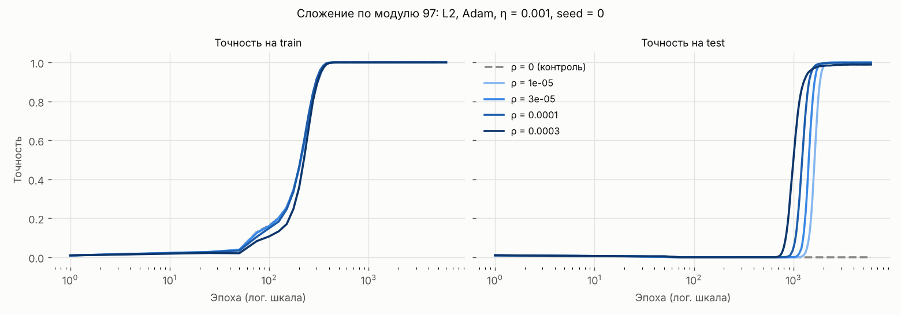
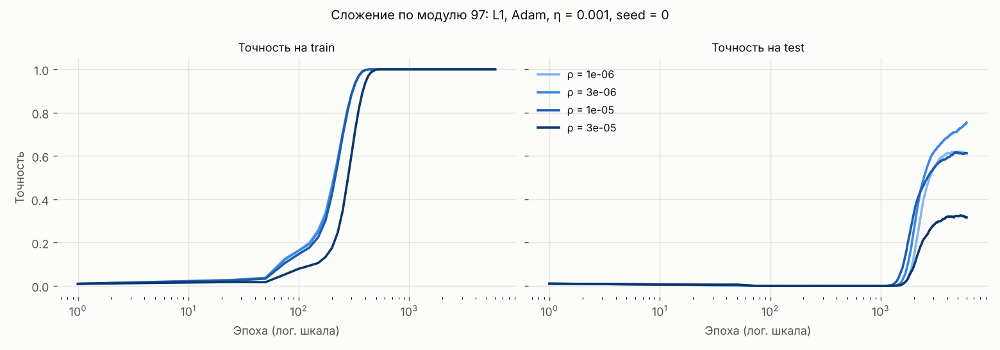

# Результаты пилота

Пилот проверяет **постановку**, а не отвечает на вопросы исследования: 2 seed на точку,
одно разбиение, короткий горизонт. Числа ниже — ориентиры для настройки сетки, в отчёт как
результаты они не идут.

## Общие условия

| Параметр | Значение |
|---|---|
| Данные | q = 97, доля train 0.4 (3764 пары), `split_seed = 0` |
| Модель | 194 → 256 → 97, ReLU, инициализация как у `nn.Linear` |
| Обучение | Adam, β = (0.9, 0.98), полнобатчевое (эпоха = шаг), float32 |
| Регуляризация | Явный штраф ρ·Σ\|w\| (L1) или ρ·Σw² (L2), только матрицы весов |
| Оборудование | CPU, 4 потока, PyTorch 2.14.1 |
| Критерий | `pilot/pilot_changepoint.py` (ступенька с одним скачком, EXPERIMENTS.md §3) |

Воспроизведение (каталоги `pilot_runs/` в `.gitignore`):

```bash
python pilot/pilot_grokking.py --reg l2 --lr 1e-3 --rhos 0 1e-5 3e-5 1e-4 3e-4 --seeds 0 1 --steps 6000 --eval-every 25 --out pilot_runs/l2_lr1e-3
python pilot/pilot_grokking.py --reg l1 --lr 1e-3 --rhos 1e-6 3e-6 1e-5 3e-5   --seeds 0 1 --steps 6000 --eval-every 25 --out pilot_runs/l1_lr1e-3
python pilot/pilot_grokking.py --reg l2 --lr 3e-4 --rhos 1e-4 --seeds 0 1 --steps 6000 --eval-every 25 --out pilot_runs/l2_lr3e-4
python pilot/pilot_grokking.py --reg l2 --lr 3e-3 --rhos 1e-4 --seeds 0 1 --steps 6000 --eval-every 25 --out pilot_runs/l2_lr3e-3
python pilot/pilot_grokking.py --reg l2 --lr 1e-3 --rhos 1e-5 1e-4 1e-3 --seeds 0 1 --steps 2000 --eval-every 50 --out pilot_runs/speed
python pilot/pilot_grokking.py --reg l1 --lr 1e-3 --rhos 3e-6 1e-5 --seeds 0 --steps 20000 --eval-every 50 --threads 2 --out pilot_runs/l1_lr1e-3_long
python pilot/pilot_grokking.py --reg l1 --lr 3e-4 --rhos 1e-6 1e-5 --seeds 0 --steps 20000 --eval-every 50 --threads 2 --out pilot_runs/l1_lr3e-4_long
python pilot/pilot_changepoint.py pilot_runs/l2_lr1e-3 pilot_runs/l2_lr3e-4 pilot_runs/l2_lr3e-3 pilot_runs/l1_lr1e-3 pilot_runs/l1_lr1e-3_long pilot_runs/l1_lr3e-4_long
python pilot/pilot_changepoint.py pilot_runs/l2_lr1e-3 --plot docs/img/pilot_grokking.png --rho 1e-4 --seed 0
python pilot/pilot_changepoint.py pilot_runs/l2_lr1e-3 --plot-sweep docs/img/pilot_l2_rho.png
python pilot/pilot_changepoint.py pilot_runs/l1_lr1e-3 --plot-sweep docs/img/pilot_l1_rho.png
```

На CPU результаты воспроизводятся бит в бит (проверено повторным запуском).

---

## 1. L2, η = 1e-3: зависимость от ρ

| ρ | Исход (оба seed) | t_mem | t_grok (seed 0 / 1) | Скачок test_acc | Итоговая test_acc |
|---|---|---|---|---|---|
| 0 | `no_generalization` | 375 | — | 0.00 | 0.000 / 0.001 |
| 1e-5 | `grokking` | 375–400 | 1650 / 1625 | 0.93 | 1.000 / 1.000 |
| 3e-5 | `grokking` | 375 | 1450 / 1450 | 0.92–0.93 | 1.000 / 1.000 |
| 1e-4 | `grokking` | 375 | 1250 / 1250 | 0.91–0.92 | 0.999 / 1.000 |
| 3e-4 | `grokking` | 375–400 | 1025 / 1050 | 0.88 | 0.989 / 0.992 |
| 1e-3 | `no_memorization` (за 2000 эпох) | — | — | — | train ≈ 0.10 |



Наблюдения:

1. **Grokking есть** при всех ρ от 1e-5 до 3e-4: запоминание к ~375-й эпохе, test_acc в этот
   момент ≈ 0, переход в 3–4 раза позже. Базовая постановка подтверждена.
2. **Без регуляризации (ρ = 0) обобщения нет** за 6000 эпох. Train-лосс падает до ~1e-7,
   test-лосс растёт до ~25. Это сценарий численного «насыщения» softmax из раздела рисков
   ARCHITECTURE.md §7. Контроль ρ = 0 включён в сетку.
3. **Верхняя граница:** при ρ = 1e-3 сеть не запоминает даже train. Граница лежит между
   3e-4 и 1e-3.
4. **Зависимость от ρ слабая:** рост ρ в 30 раз ускоряет переход в 1.6 раза. Наклон
   log t_grok по log ρ ≈ −0.14.
5. **Разброс между seed очень мал** (≤ 25–50 эпох при шаге записи 25). Значит, даже малые
   различия между ячейками сетки будут статистически значимы. В выводах нужно опираться на
   **размер эффекта**, а не только на p-значение.

## 2. L2, ρ = 1e-4: зависимость от η

| η | t_mem | t_grok (seed 0 / 1) | t_grok / t_mem | Итоговая test_acc |
|---|---|---|---|---|
| 3e-4 | 1250 / 1275 | 3950 / 3925 | 3.1–3.2 | 0.998 / 0.997 |
| 1e-3 | 375 | 1250 / 1250 | 3.3 | 0.999 / 1.000 |
| 3e-3 | 150 | 525 / 500 | 3.3–3.5 | 0.999 / 1.000 |

Наклон log t_grok по log η ≈ −0.9: переход ускоряется почти пропорционально η. Отношение
t_grok / t_mem при этом почти постоянно (~3.3). Это ориентир для гипотезы H3
(EXPERIMENTS.md §6): при Adam важен в основном η, а не произведение ηρ.

## 3. L1, η = 1e-3: частичное обобщение

| ρ | Исход (seed 0 / 1) | t_mem | t_grok (seed 0 / 1) | Скачок (seed 0 / 1) | Итоговая test_acc |
|---|---|---|---|---|---|
| 1e-6 | `partial` / `partial` | 400 | 2300 / 2175 | 0.53 / 0.56 | 0.61 / 0.70 |
| 3e-6 | `partial` / `partial` | 375–400 | 2150 / 1950 | 0.60 / 0.50 | 0.75 / 0.57 |
| 1e-5 | `partial` / `partial` | 375–400 | 1950 / 1825 | 0.51 / 0.49 | 0.61 / 0.57 |
| 3e-5 | `no_generalization` / `partial` | 475 | — / 2300 | 0.27 / 0.39 | 0.32 / 0.49 |



Наблюдения:

1. **Отложенный скачок есть и при L1**, но test_acc выходит на плато 0.3–0.75, а не на ~1.0.
2. Поэтому в критерий добавлен исход `partial` и второй отклик t_gen95 (EXPERIMENTS.md §3, §5).
   Без этого все запуски L1 попали бы в «обобщения нет».
3. При ρ = 3e-5 два seed оказались по разные стороны порога δ_min = 0.3. Анализ
   чувствительности к порогу обязателен.

### Длинные прогоны L1 (20 000 эпох, seed 0)

| η | ρ | t_mem | t_grok | test_acc на эпохе 2 тыс. / 5 тыс. / 10 тыс. / 15 тыс. / 20 тыс. |
|---|---|---|---|---|
| 1e-3 | 3e-6 | 400 | 2400 | 0.26 / 0.72 / 0.90 / 0.93 / **0.945** |
| 1e-3 | 1e-5 | 400 | 1950 | 0.34 / 0.62 / 0.58 / 0.54 / **0.54** |
| 3e-4 | 1e-6 | 1350 | 6850 | 0.00 / 0.02 / 0.52 / 0.56 / **0.56** |
| 3e-4 | 1e-5 | 1350 | 6550 | 0.00 / 0.11 / 0.62 / 0.72 / **0.85** |

4. **Момент скачка при L1 тоже масштабируется ~1/η:** ~2000–2400 при η = 1e-3 и
   ~6500–6850 при η = 3e-4. Критерий находит скачок надёжно.
5. **После скачка динамика двухфазная:** либо медленный дорост (до 0.945 к 20 тыс. эпох),
   либо деградация после пика (0.62 → 0.54). Зависимость от ρ немонотонна.
6. Поэтому горизонт для сетки — **20 000 эпох, одинаково для L1 и L2**. Для L1 отклик t_gen95
   в большинстве ячеек, вероятно, будет цензурирован, поэтому основной отклик — t_grok,
   а «полноту» обобщения описывает ā_end.

## 4. Скорость

| Реплик в батче R | 1 | 6 | 30 |
|---|---|---|---|
| Шаг обучения, мс | 12 | 89 | 449 |

На CPU ~15 мс на реплику за эпоху, векторизация по репликам не ускоряет. Бюджет сетки —
в PLAN.md, раздел «Вычислительный бюджет».

## 5. Что из этого следует для плана

| Вывод пилота | Решение |
|---|---|
| Постановка даёт grokking с L2 | `configs/base.yaml` подтверждён: q = 97, доля 0.4, H = 256, Adam, η = 1e-3 |
| ρ = 0 → нет обобщения; ρ = 1e-3 → нет запоминания | Диапазон L2 в сетке: ρ ∈ [3e-6, 3e-4] + контроль ρ = 0; нижняя граница уточняется на неделе 2 |
| Слабая зависимость от ρ, сильная от η | Гипотеза H3 сформулирована так, чтобы это проверить; вопрос об оптимизаторе вынесен на встречу команды (PLAN.md §6) |
| L1 даёт частичное и медленное обобщение | Исход `partial`, второй отклик t_gen95, анализ чувствительности порога, горизонт 20 000 эпох для обоих типов, гипотеза про Adam + L1 вынесена на встречу (PLAN.md §6) |
| Малый разброс между seed | Упор на размеры эффектов; 10 seed на ячейку достаточно |
| Критерий и порог середины совпадают с точностью до 1–2 шагов записи | Основной критерий оставляем; полноценная проверка — синтетика и ручная разметка (EXPERIMENTS.md §3.3) |
