# Эффект отложенного обобщения (grokking) при обучении нейронных сетей

Курсовая работа по дисциплине «Нейронные сети», ВИШ РУТ (МИИТ), осенний семестр 2026.

Выполнили студенты группы ШАД-411:
- **Вохмин Артур (R1)** — ядро обучения: данные, модель, цикл обучения, воспроизводимость, Фурье-анализ;
- **Фитц Артемий (R2)** — критерий момента перехода и его проверка;
- **Баранов Владимир (R3)** — сетка экспериментов, статистика, графики.

Репозиторий с кодом и данными: https://github.com/Alectobe/grokking-modular-addition

Код: `src/grokking/`, скрипты: `scripts/`, конфиги: `configs/`. Как воспроизвести каждый
результат — в разделе 9.

---

## Аннотация

Мы воспроизвели эффект отложенного обобщения (grokking) на задаче y = (x1 + x2) mod 97 с маленькой
полносвязной сетью: при η = 1e-3 и L2-штрафе ρ = 1e-4 сеть запоминает обучающие пары к ~360-й эпохе,
а обобщает лишь к ~1230-й. Для автоматического поиска момента перехода предложен критерий — подгонка
ступеньки к кривой точности на test методом наименьших квадратов на логарифмической шкале эпох;
на синтетике его медианная ошибка 2.6%, ложных срабатываний нет. На сетке из 198 сетей (L1 и L2,
3 значения η, 5 значений ρ, 6 seed и контроль без регуляризации) показано: без регуляризации перехода
нет; при Adam время перехода определяется в основном скоростью обучения (t_grok ∝ η^(−0.73)) и слабо —
коэффициентом регуляризации (ρ^(−0.15) для L2), поэтому гипотеза «важно только произведение ηρ»
отвергнута. L2 даёт полное обобщение во всех запусках, L1 — только частичное (25–72%) и в 1.9–2.2 раза
позже. Фурье-анализ весов показывает механизм: в момент перехода нейроны первого слоя становятся
синусоидами по входу; L1 сохраняет эту структуру, но выключает около двух третей нейронов.

---

## 1. Введение

**Grokking** (отложенное обобщение) — эффект, впервые описанный Power et al. (2022):
нейронная сеть сначала запоминает обучающую выборку (точность на train ≈ 100%, на test —
на уровне случайного угадывания), а затем, спустя в разы больше эпох, внезапно находит
обобщающее правило, и точность на test тоже поднимается почти до 100%.

Эффект удобно изучать на алгоритмических задачах: у них есть точное правило, которое
сеть может найти, и нет шума в разметке. Мы используем сложение по модулю простого числа.

**Задание** (формулировка курса, сокращённо):
1. Сформировать датасет всех пар (x1, x2) для y = (x1 + x2) mod q, q ~ 100, one-hot
   представление x1, x2, y; случайно выделить фиксированную долю пар для обучения.
2. Обучить небольшую полносвязную сеть, сохраняя точность на train и test; подбором η
   добиться grokking; описать, как эффект проявляется на графиках.
3. Построить кривые потерь и точности, выделить эпоху перехода от запоминания к обобщению;
   предложить числовой критерий (задачу оптимизации) для её автоматического и однозначного
   поиска; проверить его работу.
4. Повторить эксперимент для нескольких η и ρ отдельно для L1 и L2, многократно с разными
   seed; исследовать зависимость момента перехода от типа регуляризации, η и ρ.

---

## 2. Данные (п. 1)

| Параметр | Значение |
|---|---|
| q | 97 (простое) |
| Объекты | все q² = 9409 пар (x1, x2), y = (x1 + x2) mod 97 |
| Классы | 97, сбалансированы: каждому y соответствует ровно 97 пар |
| Вход | one-hot(x1) ⊕ one-hot(x2), длина 2q = 194 |
| Цель | one-hot(y), длина 97 |
| Разбиение | 40% в train (3764 пары), 60% в test (5645 пар), фиксированное (`split_seed = 0`) |

Разбиение одно для всех экспериментов. Поэтому разброс результатов между seed отражает только
случайность инициализации сети, а не выбор обучающих пар. Отдельная валидационная выборка
не нужна: η и ρ не подбираются под качество на test, это факторы эксперимента, а test нужен,
чтобы наблюдать момент обобщения.

Доля train 0.4: при меньшей доле задержка обобщения растёт, а при слишком малой обобщение
не наступает вовсе (Power et al., 2022). Значение 0.4 дало выраженную задержку уже в пилоте.

---

## 3. Модель и обучение

| Компонент | Выбор | Почему |
|---|---|---|
| Сеть | 194 → 256 → 97, ReLU, ~75 тыс. параметров | Небольшая полносвязная сеть, как требует задание; выучивает train до 100% |
| Инициализация | Как у `nn.Linear`: U(±1/√fan_in), свой генератор на каждую реплику | Веса реплики зависят только от её seed |
| Функция потерь | Перекрёстная энтропия с one-hot целью | Стандарт для классификации; one-hot цель — буквально по заданию |
| Регуляризация | Явный штраф в лоссе: ρ·Σ\|w\| (L1) или ρ·Σw² (L2), смещения не штрафуются | L1 и L2 заданы одинаково и сравнимы по форме |
| Оптимизатор | Adam, β = (0.9, 0.98), без встроенного weight decay | Стандарт в работах по grokking; регуляризация — только через штраф |
| Режим | Полный батч: одна эпоха = один шаг оптимизатора | Нет шума мини-батчей, номер эпохи однозначен |
| Длительность | 6000 эпох, метрики каждые 10 эпох | Одинаково для всех запусков |
| Точность | float32, CPU, детерминированный режим | На той же машине результаты повторяются бит в бит |

**Почему не AdamW.** У AdamW есть встроенное «развязанное» L2-затухание весов, а аналога для L1
нет. Если сравнивать L1-штраф в лоссе с L2-затуханием AdamW, мы сравнивали бы разные механизмы.
Поэтому оба типа заданы одинаково — штрафом в функции потерь.

**Обучение многих сетей сразу.** Одно задание обучает R независимых сетей (реплик) с разными
seed и ρ в одном батче: веса хранятся в тензорах формы (R, вход, выход). Реплики не влияют
друг на друга: общий лосс — сумма лоссов реплик, Adam обновляет каждый вес независимо,
глобального клиппинга градиента нет. Это проверено тестом: три реплики в одном батче
обучаются так же, как три отдельных запуска. Ещё один тест подтверждает, что ядро повторяет
пилотный прототип бит в бит, поэтому кривые обучения из пилота (`docs/PILOT_RESULTS.md`) остаются
в силе. Моменты перехода в пилоте считались ранней версией критерия и могут отличаться от
итоговых на несколько процентов.

---

## 4. Демонстрация эффекта и подбор η (п. 2)

### 4.1. Как выглядит grokking

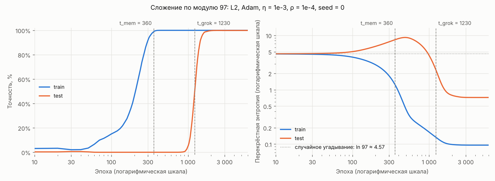

*L2, ρ = 1e-4, η = 1e-3, seed 0. Слева — точность, справа — перекрёстная энтропия; синие линии — train,
оранжевые — test. t_mem — момент запоминания train, t_grok — момент перехода по нашему критерию.*

| Эпоха | train_acc | test_acc | train CE | test CE | Что происходит |
|---|---|---|---|---|---|
| 0 | 1% | 1% | 4.58 | 4.58 | Случайная сеть: CE = ln 97, точность — случайное угадывание |
| 360 (t_mem) | 99% | **0%** | 1.23 | 8.34 | Train запомнен; на test сеть ошибается **всегда** — ниже случайного уровня |
| 490 | 100% | 0% | 0.44 | **9.16** (пик) | Сеть уверенно применяет заученное к новым парам и ошибается |
| 1000 | 100% | 5% | 0.17 | 4.27 | Test-лосс уже упал до уровня угадывания, но точность ещё мала |
| 1230 (t_grok) | 100% | 52% | 0.13 | 2.29 | Середина перехода |
| 1500 | 100% | 94% | 0.11 | 1.16 | Обобщение почти завершено |
| 6000 | 100% | 99.9% | 0.10 | 0.72 | Train-лосс не уходит в ноль: этому мешает штраф |

**Ответ на вопрос п. 2 «как эффект должен проявляться на графиках»:**
1. Точность на train выходит на 100% задолго до точности на test: между t_mem и t_grok —
   разрыв в 3.4 раза по числу эпох. На логарифмической оси эпох это два разнесённых «подъёма».
2. В промежутке тестовый лосс **растёт** (4.6 → 9.2): сеть уверенно применяет заученные ответы
   к новым парам, а они неверны. Точность на test в это время падает ниже случайного уровня.
3. Затем тестовый лосс начинает падать раньше, чем растёт точность на test: вероятность верного
   ответа уже увеличивается, но он ещё не стал самым вероятным из 97.
4. Переход резкий: test_acc поднимается с 5% до 94% примерно за 500 эпох.

### 4.2. Подбор η

L2-штраф ρ = 1e-4, по 2 seed на каждое η, 6000 эпох (`configs/lr_sweep.yaml`).

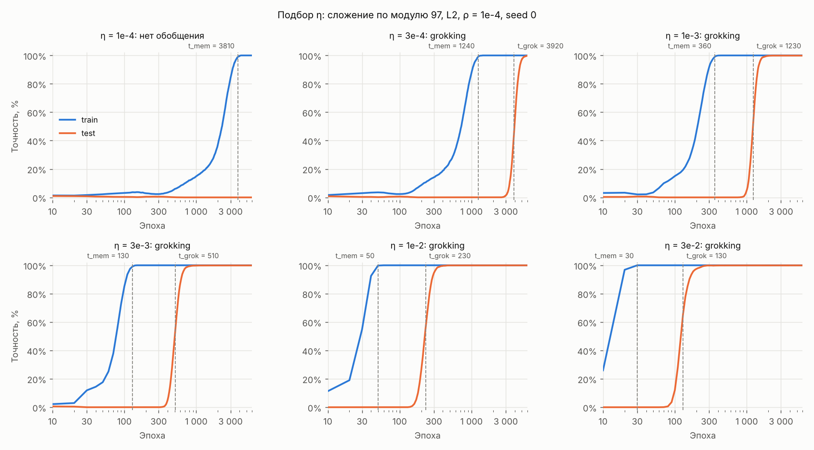

<!-- TABLE:lr_sweep -->
| η | seed | исход | t_mem | t_grok | итоговая test_acc | t_grok / t_mem |
|---|---|---|---|---|---|---|
| 1e-4 | 0 | нет обобщения | 3810 | — | 0.0% | — |
| 1e-4 | 1 | нет обобщения | 3830 | — | 0.0% | — |
| 3e-4 | 0 | grokking | 1240 | 3920 | 99.7% | 3.16 |
| 3e-4 | 1 | grokking | 1260 | 3890 | 99.6% | 3.09 |
| 1e-3 | 0 | grokking | 360 | 1230 | 99.9% | 3.42 |
| 1e-3 | 1 | grokking | 370 | 1250 | 99.9% | 3.38 |
| 3e-3 | 0 | grokking | 130 | 510 | 99.9% | 3.92 |
| 3e-3 | 1 | grokking | 130 | 500 | 100.0% | 3.85 |
| 1e-2 | 0 | grokking | 50 | 230 | 99.9% | 4.6 |
| 1e-2 | 1 | grokking | 50 | 220 | 100.0% | 4.4 |
| 3e-2 | 0 | grokking | 30 | 130 | 99.9% | 4.33 |
| 3e-2 | 1 | grokking | 30 | 130 | 99.9% | 4.33 |
<!-- /TABLE -->

**Вывод по п. 2.**
- При η = 1e-4 сеть запоминает train только к ~3800-й эпохе, и за 6000 эпох перехода нет. Если бы
  t_grok был обратно пропорционален η, переход ожидался бы около 12 000-й эпохи.
- При η от 3e-4 до 3e-2 grokking есть у обоих seed. Чем больше η, тем раньше переход: ~3900,
  ~1240, ~505, ~225 и 130 эпох. При малых η зависимость близка к 1/η (от 3e-4 до 3e-3 η выросло
  в 10 раз, t_grok уменьшился в 7.7 раза), при больших — слабее (от 3e-3 до 3e-2 — в 3.9 раза).
- Задержка между запоминанием и обобщением сохраняется при любом η: t_grok / t_mem от 3.1 до 4.6.
- Неустойчивости обучения не возникло даже при η = 3e-2.

Для демонстрации выбран η = 1e-3: обе фазы хорошо разнесены по времени и отчётливо видны
на логарифмической шкале.

---

## 5. Критерий момента перехода (п. 3)

### 5.1. Определение

Метрики записаны на эпохах t_0 = 0 < t_1 < … < t_n; a_i = test_acc(t_i), b_i = train_acc(t_i).

**Шаг 1. Момент запоминания:** t_mem = min { t_i : b_i ≥ 0.99 }.

**Шаг 2. Момент перехода — задача оптимизации.** Кривую test_acc после t_mem переводим на
равномерную сетку из M = 400 точек по логарифму эпохи u = ln t (линейная интерполяция по u);
значения на сетке — ã_1, …, ã_M. Ступенька с одним скачком подгоняется к ним так, чтобы сумма
квадратов отклонений была минимальной:

$$
k^{*} = \arg\min_{k} \left[ \sum_{j=1}^{k-1} \bigl(\tilde a_j - \mu_L(k)\bigr)^2 + \sum_{j=k}^{M} \bigl(\tilde a_j - \mu_R(k)\bigr)^2 \right],
\qquad t_{grok} = \min \{ t_i : t_i \ge e^{u_{k^{*}}} \},
$$

где μ_L(k), μ_R(k) — средние слева и справа от точки k. Величина скачка — μ_R − μ_L. Ответ —
первая записанная эпоха, не раньше точки скачка. Задача решается точно за O(M) через
префиксные суммы; при равенстве берётся наименьший k, поэтому ответ однозначен.

**Почему по логарифму эпохи.** Переход симметричен именно в логарифмическом времени: на
log-шкале кривые и рисуются. В линейном времени верхняя половина подъёма занимает больше точек,
средний уровень справа занижается, и ступенька сдвигается. Проверка на синтетике это подтвердила:
в линейном времени медианная ошибка была 4.6%, на сетке по log t — 2.6% (раздел 5.2).

**Шаг 3. Исход реплики:**

| Условие (по порядку) | Исход | t_grok |
|---|---|---|
| train_acc не достигла 99% | нет запоминания | — |
| test_acc в момент t_mem ≥ 50% | без задержки | — |
| скачок < 0.3 | нет обобщения | цензурировано: t_grok > T |
| скачок ≥ 0.3 и итоговая test_acc ≥ 95% | grokking | t_{k*} |
| скачок ≥ 0.3 и итоговая test_acc < 95% | частичное обобщение | t_{k*} |

Итоговая test_acc — среднее за последние 5% эпох. Отдельно фиксируется t_gen95 — первая эпоха,
начиная с которой test_acc ≥ 95% до конца обучения.

**Почему ступенька, а не порог «test_acc ≥ x».** Порог — произвольное число, и его выбор сдвигает
ответ. У ступеньки точку выбирает сама оптимизация; из условия оптимальности следует, что в найденной
точке test_acc ≈ (μ_L + μ_R)/2, то есть это середина подъёма. Сумма квадратов устойчива к шуму:
одиночный выброс почти не меняет её минимум.

### 5.2. Проверка критерия

**Синтетические кривые с известным моментом перехода.** 600 кривых-сигмоид по log t со
случайными параметрами: момент запоминания 100–500, задержка в 1.5–10 раз, ширина подъёма,
итоговый уровень 35–100%, шум до 3%, у 30% кривых — провал после перехода. Ошибка оценки —
|log₁₀(оценка / t*)|: 0.04 соответствует ошибке 10%.

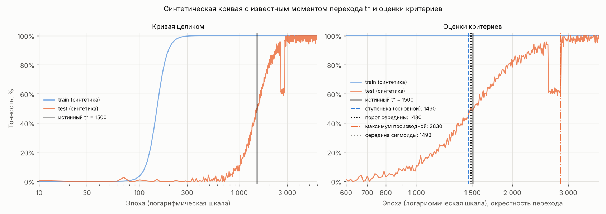

Сначала — какая доля переходов распознана. Скачок меньше 0.3 по определению не считается
переходом, поэтому кривые с низким итоговым уровнем распознаются не всегда:

<!-- TABLE:criterion_recognition -->
| итоговый уровень test_acc | кривых | распознан переход, доля |
|---|---|---|
| 35–50% | 162 | 0.66 |
| 50–70% | 168 | 0.97 |
| 70–95% | 229 | 1 |
| 95–100% | 41 | 1 |
<!-- /TABLE -->

Точность локализации на распознанных кривых:

<!-- TABLE:criterion_synthetic -->
| критерий | условие | кривых | медиана ошибки | 95-й перцентиль | в пределах 10%, доля | нет ответа, доля |
|---|---|---|---|---|---|---|
| ступенька (основной) | все | 540 | 0.0113 | 0.0618 | 0.854 | 0 |
| ступенька (основной) | переход после 1500-й эпохи | 172 | 0.0112 | 0.0825 | 0.808 | 0 |
| ступенька (основной) | с провалом после перехода | 182 | 0.00968 | 0.0828 | 0.863 | 0 |
| ступенька (основной) | неполное обобщение (high < 0.95) | 499 | 0.0113 | 0.062 | 0.858 | 0 |
| порог середины | все | 540 | 0.00542 | 0.039 | 0.95 | 0 |
| порог середины | переход после 1500-й эпохи | 172 | 0.00556 | 0.0548 | 0.872 | 0 |
| порог середины | с провалом после перехода | 182 | 0.00538 | 0.0337 | 0.962 | 0 |
| порог середины | неполное обобщение (high < 0.95) | 499 | 0.00541 | 0.0401 | 0.948 | 0 |
| максимум производной | все | 540 | 0.0351 | 0.415 | 0.535 | 0 |
| максимум производной | переход после 1500-й эпохи | 172 | 0.0339 | 0.342 | 0.558 | 0 |
| максимум производной | с провалом после перехода | 182 | 0.259 | 0.438 | 0.198 | 0 |
| максимум производной | неполное обобщение (high < 0.95) | 499 | 0.0355 | 0.415 | 0.533 | 0 |
| середина сигмоиды | все | 540 | 0.00128 | 0.0139 | 0.98 | 0 |
| середина сигмоиды | переход после 1500-й эпохи | 172 | 9.46e-04 | 0.00908 | 1 | 0 |
| середина сигмоиды | с провалом после перехода | 182 | 0.00281 | 0.0465 | 0.94 | 0 |
| середина сигмоиды | неполное обобщение (high < 0.95) | 499 | 0.00128 | 0.0146 | 0.978 | 0 |
<!-- /TABLE -->

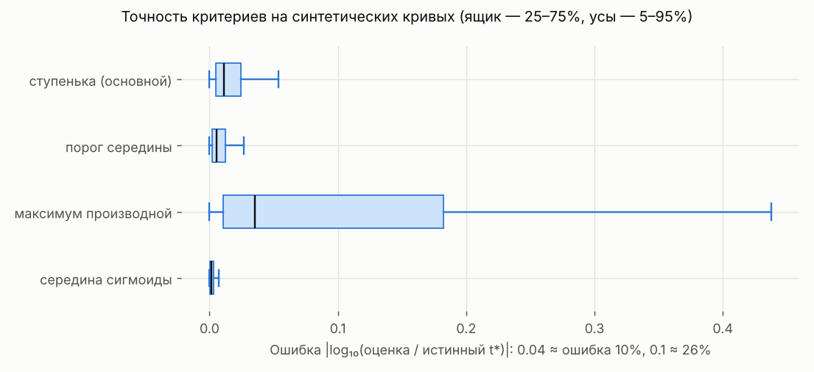

**Итог проверки на синтетике.**
- Ложных срабатываний нет: из 300 кривых без перехода (шум и медленный дрейф до 10%) ни одна
  не распознана как переход.
- Переходы с итоговым уровнем выше 50% распознаются в 97–100% случаев. При уровне 35–50% —
  только в двух третях: скачок близок к порогу 0.3, и это свойство определения, а не ошибка поиска.
- Основной критерий находит момент перехода с медианной ошибкой 2.6% (|log₁₀| = 0.011),
  95-й перцентиль — 15%; у 85% кривых ошибка меньше 10%. Провалы после перехода медианную
  ошибку не увеличивают, но немного утяжеляют хвост: 95-й перцентиль 21% против 15%.
- Порог середины и середина сигмоиды на синтетике точнее (медианная ошибка 1.3% и 0.3%). Но
  синтетические кривые построены как сигмоиды по log t, а t* определён как их середина, поэтому
  сравнение заведомо в пользу этих методов. Подгонка сигмоиды к тому же — нелинейная задача
  с риском локального минимума и зависимостью от начального приближения. Ступенька даёт точный
  глобальный оптимум, поэтому остаётся основным критерием.
- Максимум производной ненадёжен: медианная ошибка 8%, а на кривых с провалами — 82%. Он
  указывает на восстановление после провала, а не на сам переход (пример на графике выше).

**Реальные запуски сетки.** Согласие основного критерия с альтернативными:

<!-- TABLE:criterion_agreement -->
| альтернатива | тип | реплик | Спирмен с основным | медиана |log10 отношения| | 95-й перцентиль | нет ответа, доля |
|---|---|---|---|---|---|---|
| порог середины | L2 | 90 | 1 | 0.00268 | 0.00836 | 0 |
| порог середины | L1 | 85 | 0.995 | 0.009 | 0.0329 | 0 |
| максимум производной | L2 | 90 | 0.999 | 0.00545 | 0.0276 | 0 |
| максимум производной | L1 | 85 | 0.99 | 0.0185 | 0.0551 | 0 |
| середина сигмоиды | L2 | 90 | 1 | 0.0053 | 0.0114 | 0 |
| середина сигмоиды | L1 | 85 | 0.991 | 0.00879 | 0.0367 | 0 |
<!-- /TABLE -->

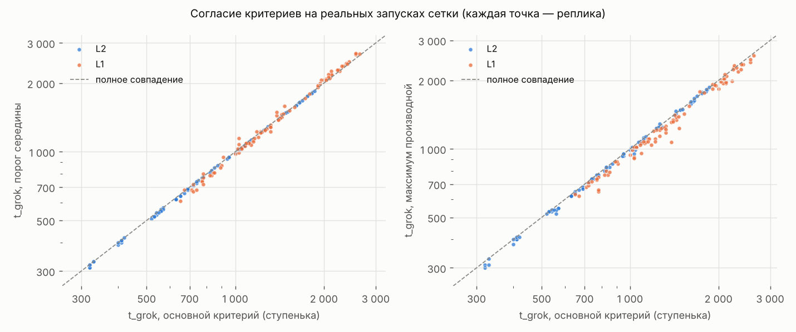

Устойчивость к частоте записи метрик (берём каждую 2-ю или 5-ю точку):

<!-- TABLE:criterion_thinning -->
| тип | прореживание | реплик | исход не изменился, доля | медиана |log10(t_grok / t_grok полн.)| | максимум |
|---|---|---|---|---|---|
| L1 | каждая 2-я точка | 85 | 1 | 0.00203 | 0.0119 |
| L1 | каждая 5-я точка | 85 | 1 | 0.00625 | 0.0238 |
| L2 | каждая 2-я точка | 90 | 1 | 0.00347 | 0.013 |
| L2 | каждая 5-я точка | 90 | 1 | 0.00963 | 0.0404 |
<!-- /TABLE -->

Чувствительность исходов к порогу скачка δ_min (реплики сетки с ρ > 0):

<!-- TABLE:criterion_threshold_sensitivity -->
| тип | порог δ_min | реплик | grokking | частичное | нет обобщения | исход отличается от δ_min = 0.3, доля |
|---|---|---|---|---|---|---|
| L1 | 0.2 | 90 | 0 | 90 | 0 | 0.0556 |
| L1 | 0.3 | 90 | 0 | 85 | 5 | 0 |
| L1 | 0.4 | 90 | 0 | 72 | 18 | 0.144 |
| L2 | 0.2 | 90 | 90 | 0 | 0 | 0 |
| L2 | 0.3 | 90 | 90 | 0 | 0 | 0 |
| L2 | 0.4 | 90 | 90 | 0 | 0 | 0 |
<!-- /TABLE -->

**Итог проверки на реальных запусках.**
- Все три альтернативы почти совпадают с основным критерием: медиана |log₁₀ отношения| от 0.003 до 0.018
  (расхождение 0.6–4.4%), ранговая корреляция 0.99–1.00. Чуть больше расхождение у L1: подъём у него
  растянут и переходит в медленный дорост.
- При записи метрик в 2 и 5 раз реже исход не меняется ни у одной реплики, а t_grok сдвигается в
  медиане не больше чем на 2.2%.
- От порога скачка δ_min исходы у L2 не зависят вовсе. У L1 при пороге 0.2 или 0.4 вместо 0.3 исход
  меняется у 6% реплик (порог 0.2) и у 14% (порог 0.4) — это граничные случаи частичного обобщения
  с небольшим скачком.

Вывод: критерий устойчив, а содержательные результаты раздела 6 от его деталей не зависят
(раздел 6.8).

---

## 6. Зависимость момента перехода от регуляризации, η и ρ (п. 4)

### 6.1. План эксперимента

Все параметры из раздела 3 зафиксированы, варьируются только тип регуляризации, η и ρ.

| Фактор | Значения |
|---|---|
| Тип | L2, L1 |
| η | 1e-3, 2e-3, 4e-3 |
| ρ для L2 | 0 (контроль без регуляризации), 3e-6, 1e-5, 3e-5, 1e-4, 3e-4 |
| ρ для L1 | 3e-7, 1e-6, 3e-6, 1e-5, 3e-5 |
| seed | 6 на каждую ячейку |
| Длительность | 6000 эпох |

Всего 198 сетей (`configs/grid_l2.yaml`, `configs/grid_l1.yaml`). Диапазоны ρ выбраны по пилоту
так, чтобы сеть ещё запоминала train: с L2 она перестаёт это делать при ρ = 1e-3, с L1 — уже
при ρ = 1e-4 (проверено отдельным прогоном, раздел 6.9).
Диапазоны для L1 и L2 разные: одинаковое ρ означает для них разную силу штрафа, потому что
Σ|w| и Σw² имеют разный масштаб, и их отношение меняется по ходу обучения. В нашей сети при
инициализации Σ|w| / Σw² ≈ 22, а к концу обучения ≈ 2.7 (медиана по запускам L2).

**Сокращение по сравнению с исходным планом.** План предполагал 10 seed, η от 3e-4 и
20 000 эпох (~34 часа CPU). Чтобы уложиться в один вечер, взяты более крупные η, при которых
переход наступает раньше, 6 seed и 6000 эпох (~3–3.5 часа CPU). Почему этого достаточно, показано
калибровкой (`docs/PILOT_RESULTS.md`): во всех углах сетки скачок наступает до 2500-й эпохи,
а разброс между seed мал.

### 6.2. Как учитываем запуски без перехода

Если к концу обучения перехода нет, мы знаем только, что t_grok > 6000. Выбросить такие запуски
нельзя: медиана занизится именно в медленных конфигурациях. Поэтому:
- медианы и квартили t_grok считаются по Каплану–Мейеру (если перехода нет ни у одной реплики,
  пишем «> T»);
- в ранговых тестах такие запуски получают t_grok = +∞.

### 6.3. Гипотезы

| # | Гипотеза | Проверка |
|---|---|---|
| H1 | При фиксированных (тип, η) t_grok убывает с ростом ρ | Корреляция Спирмена log ρ ↔ t_grok, поправка Холма |
| H2 | При фиксированных (тип, ρ) t_grok убывает с ростом η | То же по η |
| H3 | t_grok ∝ η^(−α)·ρ^(−β), причём α = β: важно только произведение η·ρ | МНК для log t_grok, 95% ДИ для α и β, t-тест α = β |
| H4 | L1 и L2 различаются | Лучшее t_grok при каждом η (Манн–Уитни, δ Клиффа), полнота обобщения (тест Фишера), разность наклонов β |
| H5 | Переход сопровождается уменьшением весов | Нормы и доля почти нулевых весов в ключевые моменты, парный тест Уилкоксона |

**Откуда H3.** Для обычного градиентного спуска с L2-штрафом шаг уменьшает веса в (1 − 2ηρ)
раз, то есть характерное время сжатия весов — порядка 1/(ηρ). С L1-штрафом модуль веса
уменьшается на ηρ за шаг — снова масштаб 1/(ηρ). Если grokking — это «сжатие» от запоминающего
решения к компактному, то t_grok должен зависеть только от произведения ηρ, и α = β = 1.
У Adam шаг нормируется, поэтому это предсказание может не выполняться — это мы и проверяем.

### 6.4. Исходы по ячейкам сетки

Медианы и квартили t_grok — по Каплану–Мейеру; «> T» — переход не наступил у большинства
реплик ячейки за 6000 эпох. t_grok/t_mem — медиана отношения по репликам с переходом.

<!-- TABLE:grid_summary -->
| тип | η | ρ | реплик | grokking | частичное | нет обобщ. | без задержки | нет запомин. | t_mem (мед.) | t_grok (мед.) | t_grok 25% | t_grok 75% | t_grok/t_mem | доля ≥95% test | итог. test_acc |
|---|---|---|---|---|---|---|---|---|---|---|---|---|---|---|---|
| L1 | 1e-3 | 3e-7 | 6 | 0 | 6 | 0 | 0 | 0 | 380 | 2500 | 2392 | 2570 | 6.58 | 0.0% | 71.9% |
| L1 | 1e-3 | 1e-6 | 6 | 0 | 6 | 0 | 0 | 0 | 380 | 2255 | 2160 | 2290 | 5.86 | 0.0% | 59.2% |
| L1 | 1e-3 | 3e-6 | 6 | 0 | 6 | 0 | 0 | 0 | 380 | 2055 | 2010 | 2108 | 5.41 | 0.0% | 58.9% |
| L1 | 1e-3 | 1e-5 | 6 | 0 | 6 | 0 | 0 | 0 | 380 | 1925 | 1820 | 1955 | 5.03 | 0.0% | 59.5% |
| L1 | 1e-3 | 3e-5 | 6 | 0 | 4 | 2 | 0 | 0 | 465 | 2120 | 2070 | > T | 4.51 | 0.0% | 43.1% |
| L1 | 2e-3 | 3e-7 | 6 | 0 | 6 | 0 | 0 | 0 | 195 | 1440 | 1425 | 1508 | 7.53 | 0.0% | 55.5% |
| L1 | 2e-3 | 1e-6 | 6 | 0 | 6 | 0 | 0 | 0 | 195 | 1350 | 1290 | 1395 | 6.82 | 0.0% | 52.3% |
| L1 | 2e-3 | 3e-6 | 6 | 0 | 6 | 0 | 0 | 0 | 195 | 1225 | 1168 | 1252 | 6.36 | 0.0% | 53.1% |
| L1 | 2e-3 | 1e-5 | 6 | 0 | 6 | 0 | 0 | 0 | 200 | 1125 | 1060 | 1175 | 5.78 | 0.0% | 53.3% |
| L1 | 2e-3 | 3e-5 | 6 | 0 | 6 | 0 | 0 | 0 | 235 | 1270 | 1205 | 1320 | 5.4 | 0.0% | 40.8% |
| L1 | 4e-3 | 3e-7 | 6 | 0 | 6 | 0 | 0 | 0 | 110 | 1065 | 1035 | 1102 | 9.95 | 0.0% | 50.0% |
| L1 | 4e-3 | 1e-6 | 6 | 0 | 6 | 0 | 0 | 0 | 110 | 970 | 902 | 1030 | 9.13 | 0.0% | 68.4% |
| L1 | 4e-3 | 3e-6 | 6 | 0 | 6 | 0 | 0 | 0 | 110 | 825 | 790 | 838 | 7.67 | 0.0% | 42.7% |
| L1 | 4e-3 | 1e-5 | 6 | 0 | 6 | 0 | 0 | 0 | 110 | 715 | 680 | 720 | 6.5 | 0.0% | 45.4% |
| L1 | 4e-3 | 3e-5 | 6 | 0 | 3 | 3 | 0 | 0 | 130 | 780 | 770 | > T | 5.92 | 0.0% | 24.7% |
| L2 | 1e-3 | 0 | 6 | 0 | 0 | 6 | 0 | 0 | 385 | > T | > T | > T | — | 0.0% | 0.0% |
| L2 | 1e-3 | 3e-6 | 6 | 6 | 0 | 0 | 0 | 0 | 380 | 1815 | 1772 | 1828 | 4.72 | 100.0% | 100.0% |
| L2 | 1e-3 | 1e-5 | 6 | 6 | 0 | 0 | 0 | 0 | 380 | 1645 | 1618 | 1650 | 4.28 | 100.0% | 100.0% |
| L2 | 1e-3 | 3e-5 | 6 | 6 | 0 | 0 | 0 | 0 | 380 | 1455 | 1430 | 1488 | 3.88 | 100.0% | 100.0% |
| L2 | 1e-3 | 1e-4 | 6 | 6 | 0 | 0 | 0 | 0 | 370 | 1250 | 1235 | 1258 | 3.39 | 100.0% | 99.9% |
| L2 | 1e-3 | 3e-4 | 6 | 6 | 0 | 0 | 0 | 0 | 385 | 1035 | 1022 | 1040 | 2.67 | 100.0% | 99.2% |
| L2 | 2e-3 | 0 | 6 | 0 | 0 | 6 | 0 | 0 | 195 | > T | > T | > T | — | 0.0% | 0.0% |
| L2 | 2e-3 | 3e-6 | 6 | 6 | 0 | 0 | 0 | 0 | 190 | 1095 | 1080 | 1110 | 5.66 | 100.0% | 100.0% |
| L2 | 2e-3 | 1e-5 | 6 | 6 | 0 | 0 | 0 | 0 | 190 | 950 | 950 | 950 | 5 | 100.0% | 100.0% |
| L2 | 2e-3 | 3e-5 | 6 | 6 | 0 | 0 | 0 | 0 | 190 | 830 | 830 | 845 | 4.37 | 100.0% | 100.0% |
| L2 | 2e-3 | 1e-4 | 6 | 6 | 0 | 0 | 0 | 0 | 190 | 690 | 690 | 690 | 3.63 | 100.0% | 99.9% |
| L2 | 2e-3 | 3e-4 | 6 | 6 | 0 | 0 | 0 | 0 | 205 | 560 | 560 | 568 | 2.76 | 100.0% | 99.2% |
| L2 | 4e-3 | 0 | 6 | 0 | 0 | 6 | 0 | 0 | 105 | > T | > T | > T | — | 0.0% | 0.0% |
| L2 | 4e-3 | 3e-6 | 6 | 6 | 0 | 0 | 0 | 0 | 110 | 760 | 742 | 770 | 7.05 | 100.0% | 100.0% |
| L2 | 4e-3 | 1e-5 | 6 | 6 | 0 | 0 | 0 | 0 | 110 | 640 | 630 | 650 | 6 | 100.0% | 100.0% |
| L2 | 4e-3 | 3e-5 | 6 | 6 | 0 | 0 | 0 | 0 | 110 | 535 | 530 | 540 | 4.95 | 100.0% | 100.0% |
| L2 | 4e-3 | 1e-4 | 6 | 6 | 0 | 0 | 0 | 0 | 105 | 410 | 402 | 410 | 3.86 | 100.0% | 99.9% |
| L2 | 4e-3 | 3e-4 | 6 | 6 | 0 | 0 | 0 | 0 | 115 | 320 | 320 | 328 | 2.79 | 100.0% | 99.1% |
<!-- /TABLE -->

**Что видно по исходам.**
- Без регуляризации (ρ = 0) перехода нет ни у одной из 18 реплик: все запомнили train, но
  test_acc к концу обучения ≈ 0.
- С L2 при любом ρ > 0 — grokking у всех 90 реплик; задержка t_grok/t_mem — от 2.7 до 7.1
  (медианы по ячейкам) и растёт с η: запоминание ускоряется с ростом η сильнее, чем переход.
- С L1 отложенный скачок есть почти всегда (у 85 реплик из 90), но обобщение частичное:
  итоговая test_acc 25–72% (медианы по ячейкам), до 95% не дошла ни одна реплика.
- Разброс между seed мал: внутри ячейки t_grok отличается от минимального до максимального
  в медиане на 5% у L2 и на 16% у L1.
- Цензурированных запусков (скачка нет до конца обучения) при ρ > 0 почти нет — 5 реплик L1 из 90, все при самом большом ρ = 3e-5.

### 6.5. Зависимость от η и ρ (H1–H3)

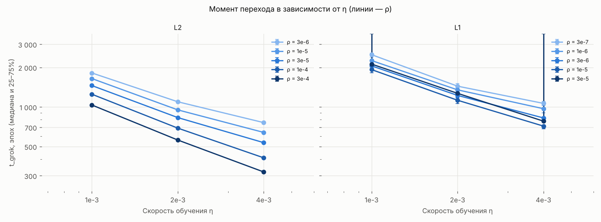

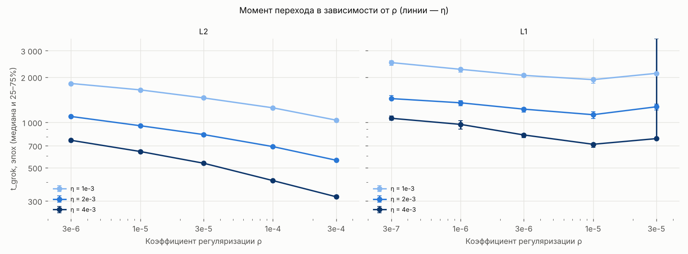

**H1: t_grok убывает с ростом ρ** (корреляция Спирмена внутри каждой пары (тип, η)):

<!-- TABLE:h1_rho_trend -->
| тип | η | реплик | r Спирмена | p | p (Холм) |
|---|---|---|---|---|---|
| L1 | 1e-3 | 30 | -0.454 | 0.0118 | 0.0236 |
| L1 | 2e-3 | 30 | -0.575 | 8.84e-04 | 0.00265 |
| L1 | 4e-3 | 30 | -0.415 | 0.0227 | 0.0236 |
| L2 | 1e-3 | 30 | -0.981 | 1.61e-21 | 6.45e-21 |
| L2 | 2e-3 | 30 | -0.986 | 4.05e-23 | 2.43e-22 |
| L2 | 4e-3 | 30 | -0.983 | 3.49e-22 | 1.74e-21 |
<!-- /TABLE -->

**H2: t_grok убывает с ростом η** (внутри каждой пары (тип, ρ)):

<!-- TABLE:h2_lr_trend -->
| тип | ρ | реплик | r Спирмена | p | p (Холм) |
|---|---|---|---|---|---|
| L1 | 3e-7 | 18 | -0.945 | 3.42e-09 | 1.71e-08 |
| L1 | 1e-6 | 18 | -0.945 | 3.67e-09 | 1.71e-08 |
| L1 | 3e-6 | 18 | -0.944 | 3.93e-09 | 1.71e-08 |
| L1 | 1e-5 | 18 | -0.945 | 3.67e-09 | 1.71e-08 |
| L1 | 3e-5 | 18 | -0.318 | 0.198 | 0.198 |
| L2 | 3e-6 | 18 | -0.947 | 2.76e-09 | 1.67e-08 |
| L2 | 1e-5 | 18 | -0.953 | 1.09e-09 | 8.74e-09 |
| L2 | 3e-5 | 18 | -0.948 | 2.39e-09 | 1.67e-08 |
| L2 | 1e-4 | 18 | -0.958 | 4.51e-10 | 4.51e-09 |
| L2 | 3e-4 | 18 | -0.956 | 6.51e-10 | 5.86e-09 |
<!-- /TABLE -->

**H3: степенной закон t_grok ∝ η^(−α)·ρ^(−β)** (МНК по log₁₀ t_grok, реплики с переходом):

<!-- TABLE:h3_scaling -->
| тип | реплик | α (по η) | α 95% ДИ | β (по ρ) | β 95% ДИ | R² | p (α = β) |
|---|---|---|---|---|---|---|---|
| L2 | 90 | 0.734 | [0.71; 0.76] | 0.151 | [0.14; 0.16] | 0.984 | 3.65e-64 |
| L1 | 85 | 0.661 | [0.62; 0.70] | 0.0607 | [0.05; 0.07] | 0.943 | 5.99e-47 |
<!-- /TABLE -->

**Итог H1–H3.**
- **η влияет сильно.** t_grok убывает с ростом η в 9 из 10 групп (тип, ρ): r Спирмена ≈ −0.95,
  значимо после поправки Холма. Исключение — L1 при ρ = 3e-5 (r = −0.32, p = 0.20), ячейка с самым
  слабым обобщением. Степенной закон: α = 0.73 для L2 и 0.66 для L1, то есть удвоение η сокращает
  время до перехода примерно в 1.6–1.7 раза.
- **ρ влияет слабо.** У L2 t_grok убывает с ростом ρ во всех трёх группах (r Спирмена ≈ −0.98),
  но наклон β = 0.15: рост ρ в 100 раз ускоряет переход лишь в 2 раза. У L1 зависимость ещё
  слабее и немонотонна: β = 0.06, r Спирмена от −0.41 до −0.58 (значимо после поправки Холма), а при
  самом большом ρ = 3e-5 переход снова замедляется.
- **Гипотеза «важно только произведение ηρ» (α = β) отвергнута** для обоих типов: α больше β
  почти в 5 раз у L2 и в 11 раз у L1 (t-тест равенства, p < 10⁻⁴⁶). Для обычного градиентного спуска ожидалось α = β = 1.

**Наше объяснение.** Adam делит шаг на скользящую оценку модуля градиента. После запоминания
градиент ошибки на train мал, и в градиенте всё больше доминирует штраф. В пределе, когда штраф
доминирует, шаг Adam по каждому весу ≈ η·sign(w) — и для L1, и для L2 он задаётся η и не зависит
от ρ. Коэффициент ρ определяет лишь, когда и насколько штраф начинает перевешивать градиент ошибки,
поэтому его влияние слабое. Это объяснение мы не проверяли отдельно: прямой проверкой был бы
повтор сетки с обычным градиентным спуском.

### 6.6. L1 против L2 (H4)

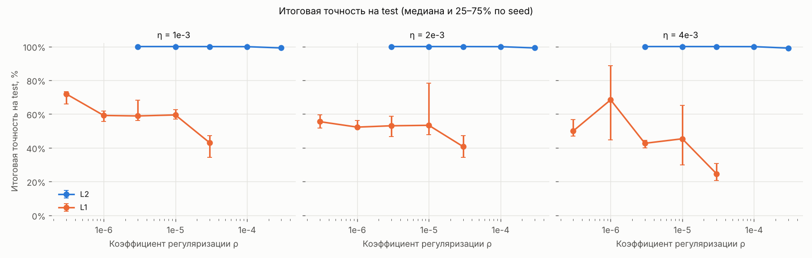

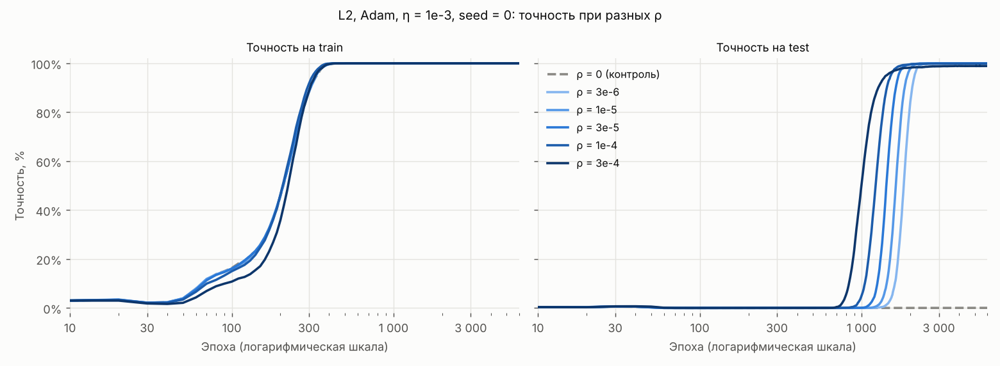

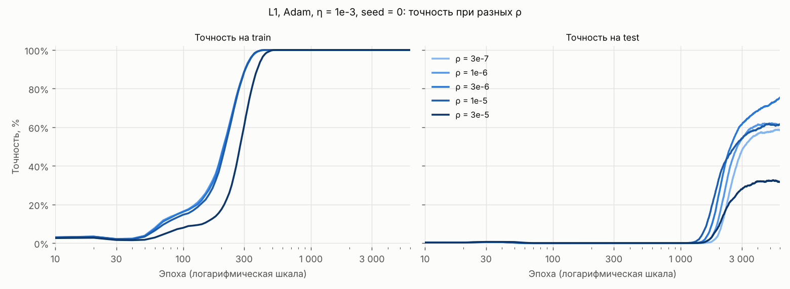

**Лучшее достижимое t_grok при каждом η** (ячейка ρ с наименьшей медианой среди ячеек, где переход
произошёл хотя бы у 80% реплик):

<!-- TABLE:h4_best_cells -->
| η | лучшее ρ (L2) | лучшее ρ (L1) | t_grok L2 | t_grok L1 | L1/L2 | L1/L2 ДИ низ | L1/L2 ДИ верх | δ Клиффа | p | p (Холм) |
|---|---|---|---|---|---|---|---|---|---|---|
| 1e-3 | 3e-4 | 1e-5 | 1035 | 1925 | 1.86 | 1.7 | 1.97 | 1 | 0.005 | 0.0126 |
| 2e-3 | 3e-4 | 1e-5 | 560 | 1125 | 2.01 | 1.83 | 2.29 | 1 | 0.00427 | 0.0126 |
| 4e-3 | 3e-4 | 1e-5 | 320 | 715 | 2.23 | 2.03 | 2.34 | 1 | 0.0042 | 0.0126 |
<!-- /TABLE -->

**Итог H4: L1 и L2 различаются.**
1. **Полнота обобщения.** До 95% на test дошли все 90 реплик L2 с ρ > 0 и ни одна из 90
   реплик L1 (точный тест Фишера, p ≈ 2·10⁻⁵³). Итоговая точность L1 — от 25% до 72% (медианы
   по ячейкам); самая низкая — при самом большом ρ = 3e-5. Разброс между seed у L1 большой: при
   η = 4e-3 и ρ = 1e-6 итоговая точность — от 36% до 93%. Лучшая реплика L1 дошла до 93%, но не до 95%.
2. **Скорость перехода.** Лучшая по t_grok конфигурация L1 обобщает в 1.9–2.2 раза позже лучшей
   L2 при том же η. δ Клиффа = 1: каждая реплика L1 медленнее каждой реплики L2; p = 0.013
   с поправкой Холма.
3. **Наклоны по ρ** различаются: β = 0.15 у L2 против 0.06 у L1 (z-тест, p ≈ 10⁻³¹).

Ячейки с одинаковым ρ мы напрямую не сравниваем: масштабы штрафов несопоставимы (раздел 6.1).

### 6.7. Что происходит с весами (H5)

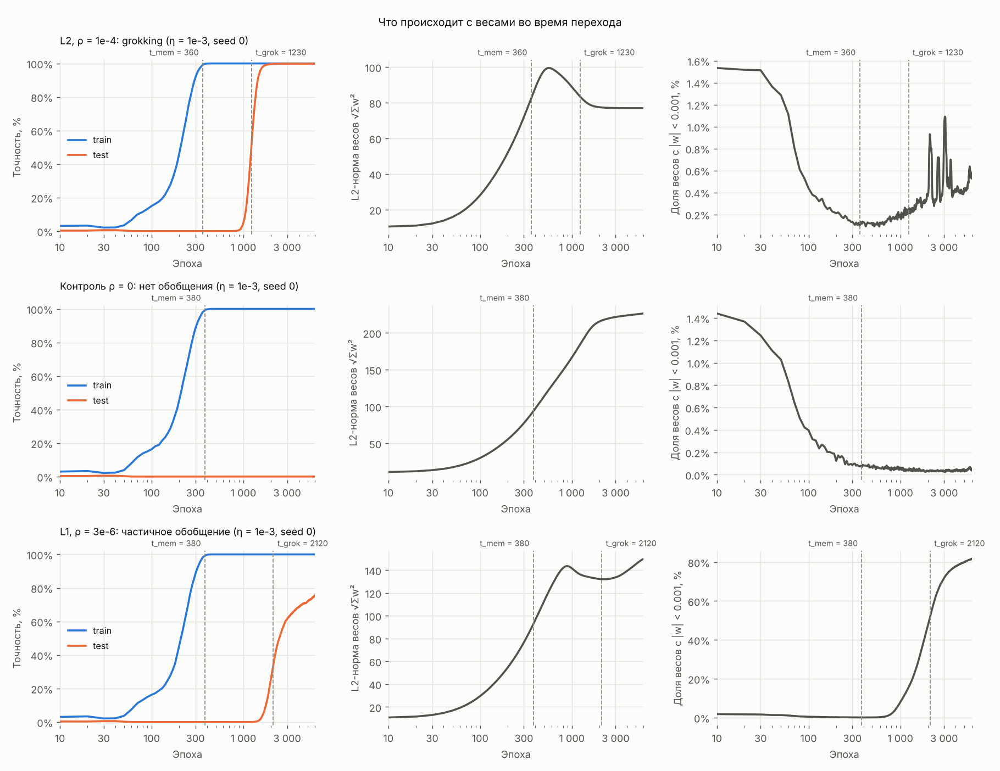

<!-- TABLE:h5_norms -->
| сравнение | реплик | медиана до | медиана после | после/до | p | p (Холм) |
|---|---|---|---|---|---|---|
| L2 с grokking: L2-норма, пик → конец | 90 | 119 | 83.9 | 0.705 | 1.74e-16 | 6.98e-16 |
| L2 с grokking: L2-норма, t_mem → конец | 90 | 92.1 | 83.9 | 0.935 | 2.86e-13 | 5.71e-13 |
| Контроль ρ = 0: L2-норма, t_mem → конец | 18 | 95.8 | 232 | 2.43 | 7.63e-06 | 7.63e-06 |
| L1 с переходом: доля |w| < 0.001, t_mem → конец | 85 | 9.13e-04 | 0.779 | 857 | 1.17e-15 | 3.51e-15 |
| Доля |w| < 0.001 в конце: L1 против L2 | 180 | 0.00595 | 0.778 | 131 | 4.88e-31 | 2.44e-30 |
<!-- /TABLE -->

**Итог H5.**
- С L2 норма весов растёт, пока сеть запоминает, достигает пика и во время перехода снижается: к
  концу она в медиане на 29% ниже пика (парный тест Уилкоксона, p ≈ 7·10⁻¹⁶ с поправкой Холма).
- Без регуляризации норма растёт до конца обучения — в 2.4 раза после t_mem.
- L1 делает сеть разреженной: к концу 78% весов по модулю меньше 0.001 (у L2 — 0.6%).
  Фурье-анализ (раздел 6.9) показывает, что выключаются целые нейроны.

Переход совпадает по времени со «сжатием» весов: при L2 уменьшается норма, при L1 веса разрежаются.
Причинность этим не доказана: это совпадение во времени, согласующееся с картиной «регуляризация
вытесняет запоминающее решение».

### 6.8. Устойчивость выводов к выбору критерия

Те же H1 и H3, посчитанные с альтернативными оценками момента перехода:

<!-- TABLE:robustness_criteria -->
| критерий | тип | α (по η) | β (по ρ) | H1: значимых групп (p Холм < 0.05) | H1: знак r |
|---|---|---|---|---|---|
| ступенька (основной) | L2 | 0.734 | 0.151 | 3 из 3 | все < 0 |
| ступенька (основной) | L1 | 0.661 | 0.0607 | 3 из 3 | все < 0 |
| порог середины | L2 | 0.739 | 0.151 | 3 из 3 | все < 0 |
| порог середины | L1 | 0.693 | 0.0641 | 3 из 3 | все < 0 |
| максимум производной | L2 | 0.743 | 0.158 | 3 из 3 | все < 0 |
| максимум производной | L1 | 0.683 | 0.0684 | 3 из 3 | все < 0 |
<!-- /TABLE -->

Выводы не зависят от выбора критерия: с порогом середины и с максимумом производной наклоны α и β
меняются не больше чем на 0.03 (α) и 0.01 (β), а тренд по ρ значим в тех же группах.

### 6.9. Механизм: нейроны становятся периодическими (доп. анализ)

Чтобы понять, *какое* правило находит сеть, мы переобучили по одной реплике L2 (ρ = 0, 3e-6, 1e-4)
и L1 (ρ = 3e-6, 1e-4) при η = 1e-3, seed 0, с сохранением весов на 17 эпохах (`configs/fourier.yaml`,
`scripts/fourier.py`). Для каждого нейрона скрытого слоя берём его веса по входу x1 — вектор
длины 97 — и раскладываем в ряд Фурье по кругу остатков 0…96.

- **Периодичность нейрона** — доля мощности в его главной частоте. У случайных весов это около 0.1
  (мощность размазана по 48 частотам), у чистой синусоиды — 1. По сети усредняем с весами,
  пропорциональными мощности нейронов.
- **Живой нейрон** — у которого произведение норм входных и выходных весов больше 1% от
  максимума по сети.

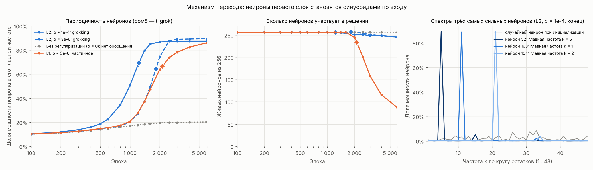

<!-- TABLE:fourier -->
| запуск | исход | t_mem | t_grok | итоговая test_acc | периодичность: начало | около t_mem | около t_grok | конец | живых нейронов в конце | разных главных частот |
|---|---|---|---|---|---|---|---|---|---|---|
| L1, ρ = 1e-4 | нет запоминания | — | — | 0.7% | 0.09 | — | — | 0.09 | 256 | 48 |
| L1, ρ = 3e-6 | частичное | 380 | 2120 | 74.8% | 0.09 | 0.14 (эп. 400) | 0.64 (эп. 2000) | 0.86 | 87 | 30 |
| L2, ρ = 1e-4 | grokking | 360 | 1230 | 99.9% | 0.09 | 0.16 (эп. 400) | 0.67 (эп. 1200) | 0.87 | 245 | 48 |
| L2, ρ = 3e-6 | grokking | 380 | 1830 | 100.0% | 0.09 | 0.13 (эп. 400) | 0.75 (эп. 2000) | 0.90 | 245 | 48 |
| Без регуляризации (ρ = 0) | нет обобщения | 380 | — | 0.0% | 0.09 | 0.13 (эп. 400) | — | 0.20 | 256 | 47 |
<!-- /TABLE -->

Наблюдения:
1. У запусков с grokking периодичность нейронов растёт с 0.1 до ~0.9, и основной рост приходится
   на окно перехода. У ρ = 1e-4 к t_grok = 1230 она уже 0.67, у ρ = 3e-6 к 2000-й эпохе
   (t_grok = 1830) — 0.75. Без регуляризации к концу обучения только 0.20 — и обобщения нет.
2. Каждый нейрон выбирает свою частоту, а вместе нейроны покрывают все 48 частот. На правой
   панели — спектры трёх самых сильных нейронов: почти вся мощность каждого сосредоточена
   в одной частоте (k = 5, 11, 21).
3. При L1 нейроны тоже становятся периодическими (0.86 к концу), но живыми остаются только 87
   нейронов из 256, и используются 30 частот из 48. Обобщение при этом частичное (75%).
4. У всех трёх запусков с переходом t_grok приходится на периодичность около двух третей
   (ромбы на левой панели). Запусков всего три, поэтому это наблюдение, а не вывод.

**Интерпретация.** Это согласуется с известным механизмом решения модульного сложения: сеть
кодирует число x набором синусоид cos(2πkx/97 + φ), а сумма по модулю получается из таких
признаков через тригонометрические тождества (Nanda et al., 2023 — для трансформера; Gromov, 2023 —
для двухслойного MLP). Мы проверили только первую часть — что признаки становятся периодическими, —
но не то, как именно сеть их комбинирует. Для L1 правдоподобное объяснение частичного обобщения:
L1 выключает большинство нейронов, и оставшихся периодических признаков не хватает для точного ответа
на всех парах. Это гипотеза; проверить её можно, увеличив ширину сети или уменьшив ρ.

---

## 7. Обсуждение

**Grokking — это смена решения, и без регуляризации её нет.** Обучающую выборку одинаково хорошо
описывают два решения: «таблица ответов» и общее правило сложения по модулю. Таблицу градиентный
спуск находит быстро, но ей нужны большие веса. Правило требует меньших весов, однако найти его
труднее. Наши данные согласуются с этой картиной (её же предлагают Liu et al., 2022, 2023):
- без штрафа норма весов растёт до конца обучения, нейроны остаются шумом, и перехода нет;
- со штрафом норма после пика падает, и именно на этом спаде нейроны первого слоя становятся
  синусоидами по входу — это признаки обобщающего правила (раздел 6.9).

**Время до перехода при Adam задаёт скорость обучения.** t_grok ∝ η^(−0.73) и слабо зависит
от ρ (β ≈ 0.15 у L2, 0.06 у L1). Наше объяснение — нормировка шага в Adam (раздел 6.5). Отсюда
практический вывод: чтобы ускорить grokking в такой постановке, эффективнее увеличить η, чем ρ.
При слишком большом ρ сеть перестаёт запоминать train (у L2 — при ρ = 1e-3, у L1 — уже при 1e-4).

**L1 находит правильные признаки, но их слишком мало.** При L1 отложенный скачок тоже есть, и нейроны
тоже становятся периодическими. Но L1 выключает около двух третей нейронов, и обобщение остаётся
частичным. Это перекликается с основной идеей статьи из задания: grokking вызывает малая
регуляризация того свойства, которым обладает обобщающее решение. Наша интерпретация: L1 поощряет
разреженность в базисе весов, а обобщающее решение разрежено в базисе частот — каждый нейрон
является плотной синусоидой, ненулевой на всех 97 входах. Поэтому L1 и правило сложения частично
конфликтуют. Это интерпретация, а не доказанный механизм.

**Критерий.** Ступенька по логарифму эпох однозначна, устойчива к шуму и к частоте записи, и все
содержательные выводы сохраняются при замене её на альтернативные критерии.

### Ограничения

- **Сокращённая сетка:** 6 seed, η в диапазоне ×4 (1e-3…4e-3), 6000 эпох. При L1 обобщение может
  продолжаться и после 6000-й эпохи: в пилоте одна конфигурация дошла до 94.5% к 20 000-й эпохе.
- **Одна постановка:** одно разбиение train/test, одна архитектура (один скрытый слой на 256
  нейронов), один оптимизатор (Adam). Вывод «η важнее ρ» относится к Adam.
- **Гипотезы без отдельной проверки:** объяснение точности ниже случайной в фазе запоминания,
  роль нормировки Adam, роль числа живых нейронов при L1.
- **Не сделано:** ручная разметка моментов перехода людьми (проверка критерия против человека).

---

## 8. Выводы

1. **Grokking воспроизведён** (п. 1–2): сеть 194 → 256 → 97 запоминает обучающие пары к ~360-й
   эпохе, а обобщает к ~1230-й (η = 1e-3, L2, ρ = 1e-4). Эффект есть при η от 3e-4 до 3e-2; при
   η = 1e-4 переход не успевает наступить за 6000 эпох. На графиках он виден как разрыв в 3–5 раз
   между выходом train_acc и test_acc на 100%, рост тестового лосса в промежутке и резкий скачок
   test_acc.
2. **Критерий момента перехода** (п. 3) — ступенька с одним скачком, подогнанная методом наименьших
   квадратов к кривой test_acc на логарифмической шкале эпох. Решение точное, единственное и
   находится за линейное время. На синтетике медианная ошибка 2.6%, ложных срабатываний нет; на
   реальных запусках он согласуется с альтернативными критериями в пределах нескольких процентов.
3. **Зависимость от η и ρ** (п. 4): без регуляризации перехода нет; t_grok ∝ η^(−0.73)·ρ^(−0.15)
   для L2. При Adam главную роль играет скорость обучения, гипотеза «важно только ηρ» отвергнута.
4. **L1 против L2** (п. 4): L2 даёт полное обобщение во всех запусках, L1 — только частичное
   (25–72%) и в 1.9–2.2 раза позже. L1 делает сеть разреженной и выключает около двух третей нейронов.
5. **Механизм:** в момент перехода нейроны первого слоя становятся синусоидами по входу
   (периодичность 0.1 → 0.9), что согласуется с известным Фурье-механизмом модульного сложения.


---

## 9. Воспроизведение

Все seed зафиксированы, вычисления детерминированы. На той же машине и с тем же числом потоков
результаты совпадают бит в бит. Метрики всех запусков лежат в `results/`, поэтому таблицы и
графики этого отчёта перестраиваются без переобучения:

```bash
pip install -r requirements.txt
python scripts/detect.py --results results/lr_sweep results/grid_l2 results/grid_l1 --out results/detections.csv
python scripts/validate_criterion.py --detections results/detections.csv \
    --results results/grid_l2 results/grid_l1 --figures report/figures --tables report/tables
python scripts/analyze.py --detections results/detections.csv --results results \
    --figures report/figures --tables report/tables
```

Обучение с нуля — одна команда, ~3 часа на 4-ядерном CPU:

```bash
python scripts/run_grid.py --grid configs/lr_sweep.yaml configs/grid_l2.yaml configs/grid_l1.yaml --order lr
```

Тесты (`python -m pytest -q`, 35 тестов) проверяют датасет, независимость реплик в батче,
совпадение итогового кода с пилотным прототипом бит в бит, критерий против полного перебора
и статистические функции на примерах с известным ответом.

---

## 10. Вклад участников

| Участник и роль | Что сделано | Модули |
|---|---|---|
| Вохмин Артур (R1) — ядро обучения | Датасет, модель с обучением многих сетей в одном батче, цикл обучения, конфиги, хранение результатов, воспроизводимость, запуск сетки | `config`, `data`, `model`, `regularization`, `train`, `storage`, `grid`, `utils`; `run_grid.py`, `train.py` |
| Фитц Артемий (R2) — критерий перехода | Критерий-ступенька и альтернативные критерии, классификация исходов, проверка на синтетике, согласие критериев, чувствительность к параметрам | `detection`; `detect.py`, `validate_criterion.py` |
| Баранов Владимир (R3) — эксперименты и статистика | План сетки, учёт цензурирования, проверка гипотез H1–H5, графики и таблицы | `stats`, `plotting`, `report`; `analyze.py` |

Отчёт и сценарий выступления писали все трое, каждый — разделы по своей зоне.

---

## Литература

1. Power A., Burda Y., Edwards H., Babuschkin I., Misra V. *Grokking: Generalization Beyond Overfitting on Small Algorithmic Datasets*, 2022. arXiv:2201.02177.
2. *Grokking Beyond the Euclidean Norm of Model Parameters*. PMLR 267:28552–28618, 2025 (статья из задания).
3. Liu Z., Kitouni O., Nolte N., Michaud E., Tegmark M., Williams M. *Towards Understanding Grokking: An Effective Theory of Representation Learning*. NeurIPS 2022. arXiv:2205.10343.
4. Liu Z., Michaud E., Tegmark M. *Omnigrok: Grokking Beyond Algorithmic Data*. ICLR 2023. arXiv:2210.01117.
5. Nanda N., Chan L., Lieberum T., Smith J., Steinhardt J. *Progress Measures for Grokking via Mechanistic Interpretability*. ICLR 2023. arXiv:2301.05217.
6. Gromov A. *Grokking Modular Arithmetic*, 2023. arXiv:2301.02679.
7. Loshchilov I., Hutter F. *Decoupled Weight Decay Regularization*. ICLR 2019.
8. Prieto L. et al. *Grokking at the Edge of Numerical Stability*, 2025.
